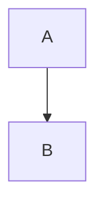

# Round-trip corpus

Every construct in this document converts to Polarion HTML and back unchanged: **bold**, *italic*, ~~struck~~, ++underlined++, ==highlighted==, x^2^ and H~2~O.

## Inline formatting

**Bold with *italic* inside** and *italic with `code` inside*.\
A hard break starts this line.\
And another one.

Inline code `let x = 1;`, a span with a backtick ``a`b`` and one with backticks at its edges `` `x` ``.

Text with <span style="color: #FF0000;">red words</span> keeps its colour as inline HTML.

### Links and images

A [plain link](https://example.com/page), a [titled link](https://example.com/page "Page title"), a [**bold link**](https://example.com/bold) and an autolink <https://example.com/docs>.


\
Figure 1: the photo above with its caption line.

#### Work items and formulas

See PROJ-123 and MP-42 (ABC-7), but not UTF\-8 or ISO\-26262.

Inline math $E = mc^2$, code math $`a$b`$ and a display formula $$\int_0^1 x\,dx$$ in a sentence.

```math
f(x) = x^2 \\
g(x) = 2x
```

##### Code

```rust
fn main() {
    println!("Hello, world!");
}
```

```
plain code block
    indented line
```



###### Lists

- bullet one
- bullet two
  - nested bullet
  - another nested bullet

Ordered from three:

3. third
4. fourth
   1. nested ordered

Tasks:

- [ ] open task
- [x] done task

A loose list:

- loose item
  
  with a second paragraph

- another loose item

Two lists in a row:

- first list

<!-- end list -->

- second list

## Quotes and alerts

> quoted text
> 
> > nested quote

> - a list in a quote

> [!NOTE]
> A note.

> [!TIP]
> A tip.

> [!IMPORTANT]
> Something important.

> [!WARNING]
> A warning.
> 
> With a second paragraph.

> [!CAUTION]
> Be careful.

## Tables

| Left | Center | Right |
| --- | :-: | --: |
| `code` | **bold** | a \| b |
| PROJ-9 | $x$ | 10 |

-----

<div style="text-align: center;">

Centered text

</div>

## Escapes

Escapes: \$5, 2\^10, a \=\= b, C\+\+, \&\#38;, www\.example.com, https\://example.com, 2 \* 3, snake\_case, \[brackets\], \<angle\>, back\\slash, \~tilde, bang\!, user\@example.com and AT\&T.

\| a pipe at the start of a line

\- not a list\
\+ not a list either\
1\. not an ordered list\
\# not a heading\
\: not a directive\
\> not a quote

Unicode: Grüße, naïve café, Ελληνικά, 日本語, "quotes" and it's, and a non-breaking space in 10 km.
