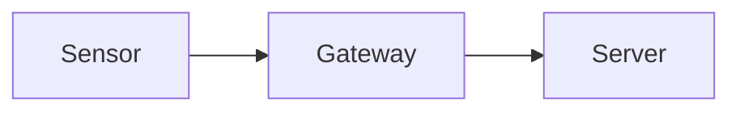

## Setup notes

Install the tool, then run it:

```
tool init
tool run --verbose
    --config site.toml
```

To check the version:

> `tool --version`

The configuration is read like this:

```
let path = "site.toml";
let retries = 3;
```

The data flow:



A helper script:

```python
def greet(name):
    return f"Hello, {name}"

```

End of the notes.
