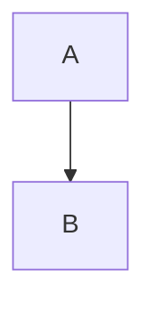

Plain pre and code:

```
let x = 1;
```

A language class on the code element:

```rust
let y = 2;
```

Highlighted output:

```rust
let z = 3;
```

Coloured spans:

```
let w = 4;
```

Breaks inside:

```
first
second
third
```

Other ways to name the language:

```python
print(1)
```

```sql
SELECT 1;
```

A diagram source:



After the code.
