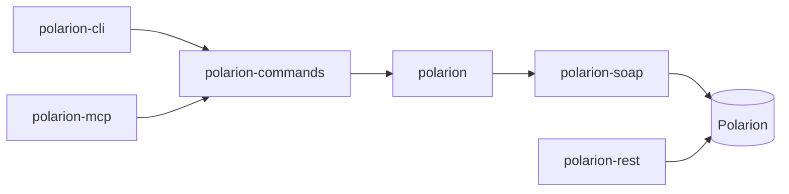

# Polarion-rs internals

How the crates fit together and how a call travels through them, for people changing the code. Installing and using
the tools is covered by the [README](../README.md).

| Page | What it covers |
|---|---|
| [Architecture](architecture.md) | The crate layers, why SOAP is the backbone, where each concern lives, one call from end to end |
| [SOAP client](soap-client.md) | `polarion-soap` at run time: envelopes, the shared session and its renewal, the read-only allowlist, untyped values, errors |
| [Library](library.md) | `polarion`: area handles, domain types and conversions, the write guard, the coverage contract |
| [Commands](commands.md) | `polarion-commands` and its macros: command DTOs, the generated catalog, JSON arguments, output schemas |
| [Front ends](front-ends.md) | The `polarion` CLI and the `polarion-mcp` server: dispatch, tool selection, attachments, HTTP |
| [Code generation](code-generation.md) | `xtask`: the REST client from the OpenAPI spec, the SOAP client from the WSDLs |
| [Testing](testing.md) | Test layers, the coverage chain, live tests against testdrive |

Read [Architecture](architecture.md) first; the other pages go one layer deeper each and can be read on their own.
The diagrams name real functions, types and files. When you change one of them, update the page that shows it.
