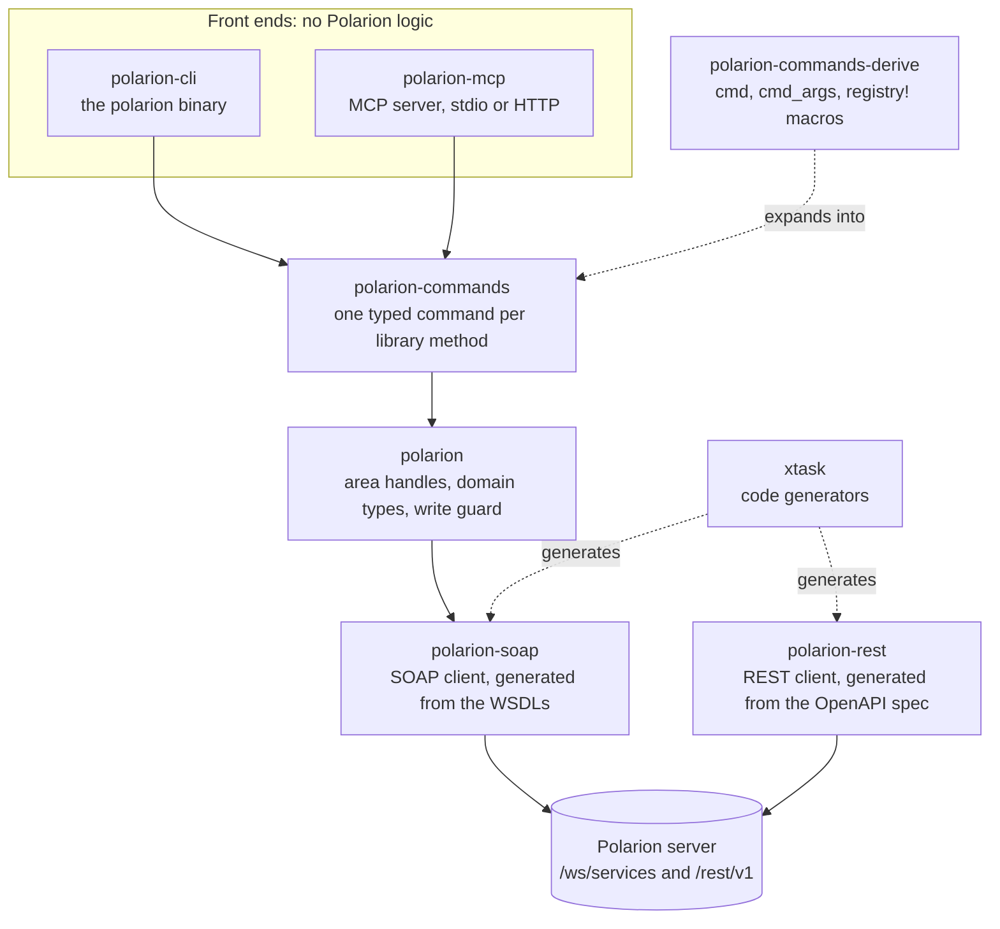
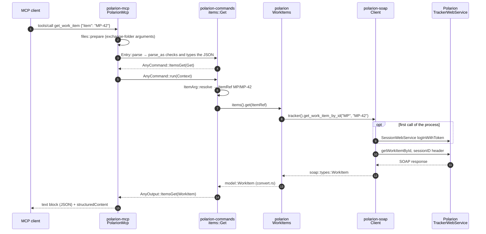

# Architecture

## Crate layers

Every arrow is a Cargo dependency (the front ends also use `polarion` types directly). Dependencies only point
down. `polarion-rest` stands alone: nothing builds on it.

| Crate | Hand-written | Generated |
|---|---|---|
| [`polarion-soap`](../crates/polarion-soap) | `client.rs` (envelope, session, faults), `xml.rs`, `error.rs` | `src/generated/` (types, services), `tests/spec_examples.rs` |
| [`polarion-rest`](../crates/polarion-rest) | `client.rs` (HTTP, pagination), `jsonapi.rs`, `query.rs`, `error.rs` | `src/generated/` (models, operations), `tests/spec_examples.rs` |
| [`polarion`](../crates/polarion) | everything | nothing |
| [`polarion-commands`](../crates/polarion-commands) | the DTOs and their `impl Run` | serde, schemas, clap and the catalog, by the macros |
| [`polarion-cli`](../crates/polarion-cli), [`polarion-mcp`](../crates/polarion-mcp) | the front-end plumbing | the commands and tools, at compile or run time, from the catalog |

## Why SOAP is the backbone

Polarion protects its REST API with its own role permissions. By default only `admin` and `project_admin` have them,
so ordinary users get `403 Forbidden` on every REST endpoint, even for projects they can open in the UI. The SOAP web
services follow the normal project permissions instead. The 2410 REST API also lacks things SOAP has: document
listing, SQL queries, baselines, wiki pages.

So the library, and everything above it, is built on `polarion-soap`. Every one of the 302 SOAP operations is
reachable through a library method, and every library method through a command (see [Testing](testing.md#the-coverage-chain)).
`polarion-rest` is a complete client for those who have the REST permissions, but nothing else depends on it.

## Where things live

| Concern | Where |
|---|---|
| SOAP envelope, session, renewal after expiry, faults | [`polarion-soap/src/client.rs`](../crates/polarion-soap/src/client.rs) |
| XML encoding and decoding of every SOAP type | generated [`types.rs`](../crates/polarion-soap/src/generated/types.rs), helpers in [`xml.rs`](../crates/polarion-soap/src/xml.rs) |
| Which SOAP operations count as reads | `READ_PREFIXES`/`OTHER_READS` in [`xtask/src/soap/emit.rs`](../xtask/src/soap/emit.rs) |
| Domain types (`WorkItem`, `Document`, ...) | [`polarion/src/model.rs`](../crates/polarion/src/model.rs) |
| SOAP types to domain types | [`polarion/src/convert.rs`](../crates/polarion/src/convert.rs) |
| Write inputs, typing of custom field JSON | [`polarion/src/write.rs`](../crates/polarion/src/write.rs) |
| Work item and document references, URIs | [`polarion/src/uri.rs`](../crates/polarion/src/uri.rs) |
| The write guard (`check_write` and friends) | [`polarion/src/client.rs`](../crates/polarion/src/client.rs) |
| Commands, one module per area | [`polarion-commands/src/`](../crates/polarion-commands/src) (`items.rs`, `documents.rs`, ...) |
| Argument types, result types | [`arg.rs`](../crates/polarion-commands/src/arg.rs), [`output.rs`](../crates/polarion-commands/src/output.rs) |
| JSON arguments to a typed command | `parse_as` in [`command.rs`](../crates/polarion-commands/src/command.rs) |
| Connection settings from the environment | [`polarion-commands/src/config.rs`](../crates/polarion-commands/src/config.rs) |
| Command line, text output | [`polarion-cli/src/cli.rs`](../crates/polarion-cli/src/cli.rs), [`render.rs`](../crates/polarion-cli/src/render.rs) |
| MCP tools and dispatch | [`polarion-mcp/src/server.rs`](../crates/polarion-mcp/src/server.rs) |
| Which MCP tools are offered | [`polarion-mcp/src/config.rs`](../crates/polarion-mcp/src/config.rs) |
| Files over MCP (images, exchange folder) | [`polarion-mcp/src/files.rs`](../crates/polarion-mcp/src/files.rs) |
| MCP over HTTP (bearer token, Host/Origin checks) | [`polarion-mcp/src/http.rs`](../crates/polarion-mcp/src/http.rs) |

## One call from end to end

An agent asks the MCP server (stdio) for work item `MP-42`, with `POLARION_PROJECT=MP` as the default project:

The CLI takes the same path from `AnyCommand::run` down. Its `AnyCommand` comes from clap instead of JSON, and its
result is printed instead of returned (see [Front ends](front-ends.md)).

## Design rules

- **Front ends hold no Polarion logic.** The CLI's command tree and the MCP tools are generated from the command
  catalog. A new library method gets a command, and with it a CLI subcommand and an MCP command (see
  [Commands](commands.md)).
- **Types inside, serialization at the boundary.** Commands, arguments and results are Rust types. JSON (or YAML,
  or command-line arguments) only appears where data leaves or enters the process, and that code is generated.
  Only values whose type is known at run time stay JSON: custom fields, test parameters.
- **Read-only unless told otherwise.** `Polarion::new` writes nothing. Writes are allowed per project, or globally,
  and are checked twice: by the library's write guard, and by the SOAP client's read-only mode when no writes are
  enabled at all (see [Library](library.md#the-write-guard)).
- **The whole API, provably.** Coverage tests fail when a SOAP operation has no library method, or a library method
  has no command (see [Testing](testing.md)).
