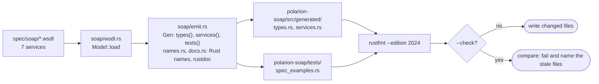
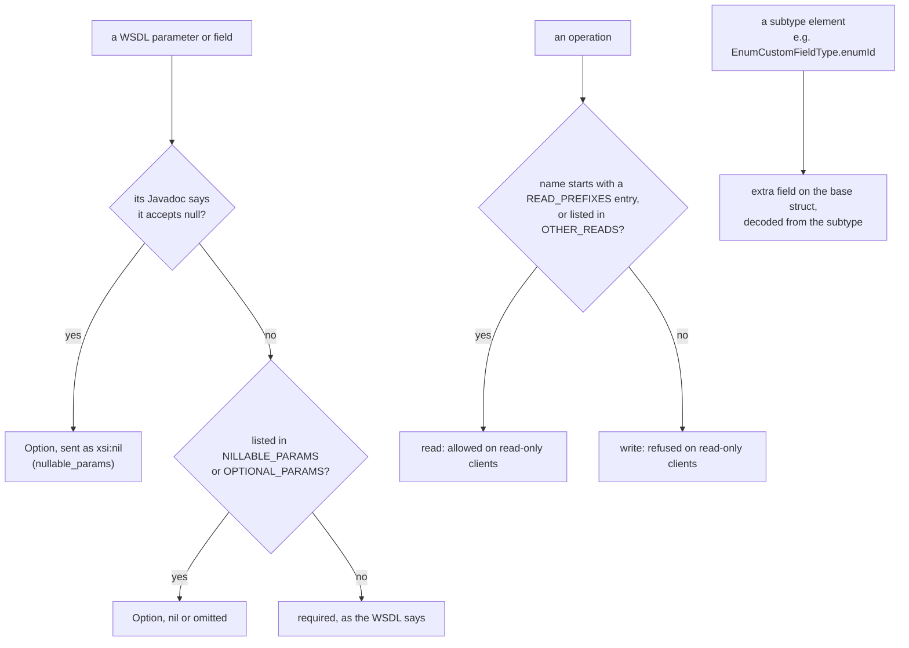

# Code generation (`xtask`)

The SOAP client is generated from the WSDLs Polarion serves. The generated code is committed,
so building the workspace needs no generator. CI runs `cargo xtask codegen --check` and fails when the committed
code is stale.

```sh
cargo xtask codegen          # regenerate
cargo xtask codegen --check  # verify it is up to date
```

Never edit `src/generated/*` or `tests/spec_examples.rs` by hand: change the generator and regenerate.

## The pipeline



`cargo xtask codegen` runs it ([`xtask/src/main.rs`](../xtask/src/main.rs)).

## SOAP: `spec/soap/*.wsdl` → `polarion-soap`

The WSDLs come from a Polarion 2410 server (`<polarion>/ws/services/<Name>WebService?wsdl`, no login needed). The
SOAP API barely changes between versions: compared with testdrive's newer release, all 302 operations are
the same, and the only type difference is `Hyperlink.title`, which 2410 lacks.

[`soap/emit.rs`](../xtask/src/soap/emit.rs) generates:

| Output | What it contains |
|---|---|
| `types.rs` | a struct per complex type with XML encoding and decoding; `Serialize` (feature `serde`) and a `JsonSchema` that mirrors it (feature `schemars`); `AnyValue` with a variant per type; `NAMESPACES` |
| `services.rs` | one accessor per service (`client.tracker()`), one method per operation, each passing the operation's read-only flag to `Client::call` |
| `tests/spec_examples.rs` | a round-trip test per type, directly and as an `xsi:type`-tagged `AnyValue` |

Javadoc in the WSDLs becomes the method docs. The WSDLs don't say everything, so the generator corrects them:



## Round-trip tests

Both `spec_examples.rs` suites build an example document from every schema, independently of the generator's type
model, and check that it survives a trip through the generated types. A mapping gap therefore shows up as a test
failure, not as a silently dropped field.
