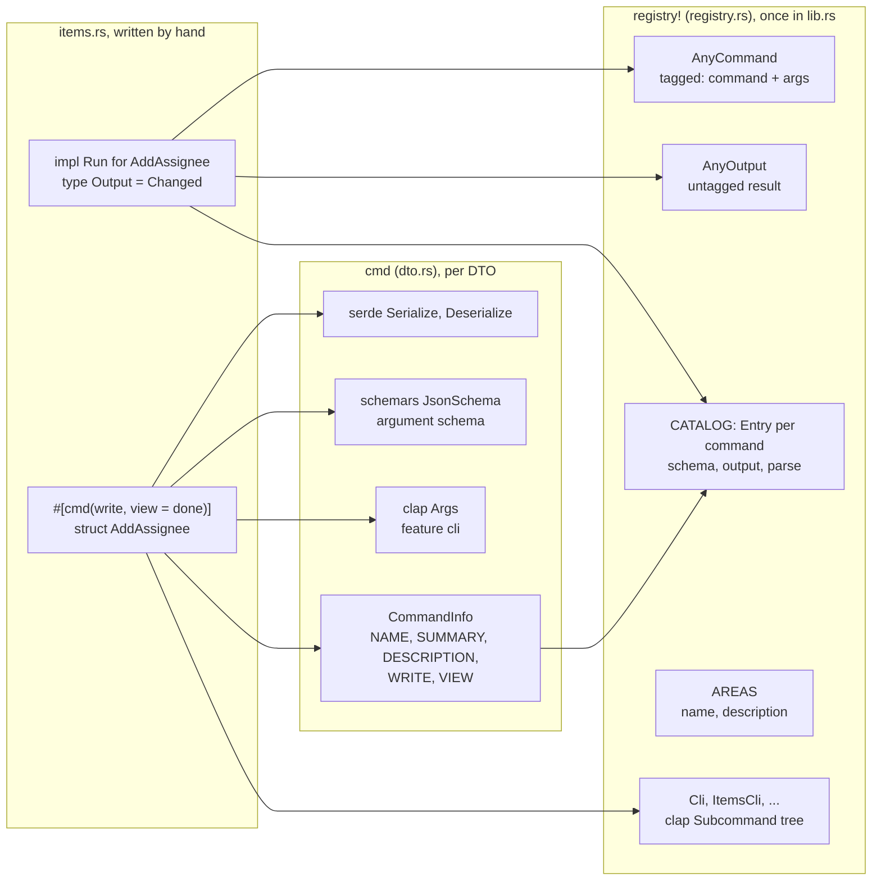
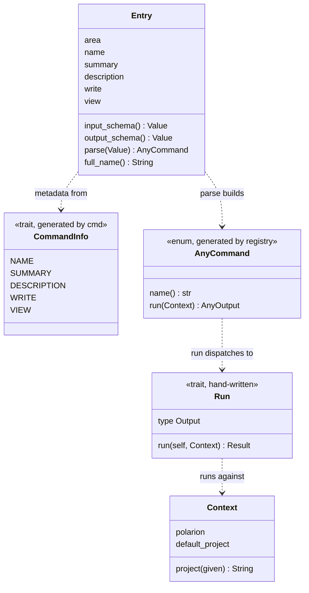
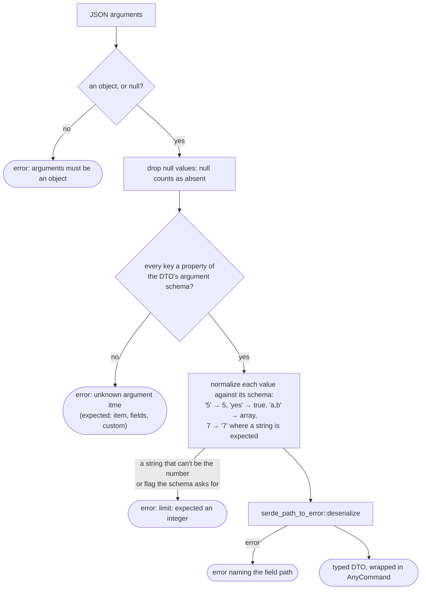

# Commands (`polarion-commands`)

Every public library method is a **command**: a DTO with typed arguments, a typed result and a hand-written `run`.
The CLI and the MCP server are generated from the commands, so they can't drift from the library. Serialization
only happens at the boundaries, and it is generated by the macros in
[`polarion-commands-derive`](../crates/polarion-commands-derive).

## A command

```rust
/// Assign a user.
#[cmd(write, view = done)]
pub struct AddAssignee {
    /// Work item: ID (in the default project), PROJECT/ID, or URI
    #[positional]
    pub item: ItemArg,
    /// User id
    pub user: String,
}

impl Run for AddAssignee {
    type Output = Changed;

    async fn run(self, cx: &Context<'_>) -> Result<Changed> {
        Ok(cx.polarion.items().add_assignee(&self.item.resolve(cx)?, &self.user).await?.into())
    }
}
```

- **Name and help:** the name (`items.add-assignee`) comes from the area and the kebab-cased type name, the summary
  from the first doc paragraph, and each argument's help from its doc comment.
- **`#[cmd(...)]` options:** `write` marks commands that modify data; their description says so (as does the end
  of `--help` when the doc comment has more paragraphs), and the MCP tool is annotated as not read-only. `view`
  says how the CLI shows the result: `object`, `lines`, `links`, `scalar` (one line), `text` (as it is, for
  Markdown), `bytes`, `done` or `table(COLUMNS)`.
- **Fields:** `#[positional]` makes a field positional on the command line, and `#[flatten]` inlines a
  `#[cmd_args]` group (e.g. `QueryArgs`). A field named `project` is not an option: the global `-p` (or
  `POLARION_PROJECT`) sets the default project instead.

## What the macros generate



`registry!` in [`lib.rs`](../crates/polarion-commands/src/lib.rs) lists every DTO by area (`items => [Get, Query,
...]`, `tests = tests_mgmt => [...]`) and generates:

| Item | What it is | Used by |
|---|---|---|
| `AnyCommand` | enum of every command, serde-tagged as `{"command": "items.get", "args": {...}}`; `name()`, `run(cx)` (each command's future built and boxed by `command::boxed`, so the dispatch frame holds a pointer, not every future: unoptimized builds would otherwise overflow the 1 MB main-thread stack on Windows) | CLI, MCP, `call` |
| `AnyOutput` | enum of every result type, serialized untagged as the result itself | CLI, MCP |
| `CATALOG: [Entry; N]` | metadata, argument schema, output schema and JSON parser per command | MCP tools, `polarion commands` |
| `AREAS` | area names with a one-line description | `polarion commands`, `polarion_commands` |
| `Cli`, `{Area}Cli` | the clap subcommand tree, `From<Cli> for AnyCommand` (feature `cli`) | CLI |



`Run::Output` must implement `Serialize` and `JsonSchema`, and the schema must describe the serialized form: it
becomes the MCP output schema.

## Argument types

Arguments are typed; fixed value sets are enums. The shared types in [`arg.rs`](../crates/polarion-commands/src/arg.rs)
accept what people and agents write and resolve against the `Context`:

| Type | Accepts | Becomes |
|---|---|---|
| `ItemArg` | `ID` (default project), `PROJECT/ID`, a URI, `{project, id}` or `{uri}` | `ItemRef` via `resolve(cx)` |
| `DocumentArg` | `SPACE/NAME`, `PROJECT/SPACE/NAME`, a URI, or the object forms | `DocumentRef` via `resolve(cx)` |
| `RichText` | a string (plain text) or `{"type": "text/html", "content": "..."}` | `polarion::Text` |
| `FieldSelection` | `standard`, `all`, or a list of field keys | `polarion::Fields` |
| `Data` | base64; on the command line also `@FILE` | bytes |
| `TextArg` | the text itself (JSON never reads files); on the command line also `@FILE`, `@-` (standard input), `@@...` (a literal `@...`); files in UTF-8 or UTF-16 with a byte order mark. The `#[cmd]` macro lets such an option take values that start with `-` and adds the file forms to its help only | `String` (e.g. Markdown) |
| `QueryArgs` | query, project, sort, limit, all, fields, custom, baseline, revision (flattened into the query commands) | `polarion::Query` |
| `LinkArg` | `ROLE=ITEM`, `ROLE=ITEM@REVISION` or `{role, item, revision?, suspect?}` (split at the first `=`, the revision after the last `@`) | `polarion::NewLink` via `resolve(cx)` |
| `HyperlinkArg` | `ROLE=URL` or `{role, url}` (a role with `:` or `/` is refused: a URL given without its role) | hyperlinks and external links |
| `OslcLinkArg` | `ROLE=LABEL=URL` or `{role, label, url}` | `polarion::NewOslcLink` |
| `ConstraintArg` | `CONSTRAINT=DATE` or `{constraint, date}` | `polarion::NewPlanningConstraint` |
| `RevisionArg` | `REVISION`, `REPOSITORY=REVISION` or `{repository?, revision}` | `polarion::NewLinkedRevision` |
| `PlanArg` | a plan URI, `ID` (default project) or `PROJECT/ID` | the plan's URI via `resolve(cx)` (an id is looked up) |

A list argument is comma-separated on the command line (`--categories a,b`), so a comma inside a URL must be
percent-encoded there. Field groups shared by a create and an update are flattened `#[cmd_args]` structs:
`TestRunFields` (`tests.create`, `tests.update`) and `PlanFields` (`plans.create`, `plans.update`); the create
commands send them after the create, in the same transaction (see [Library](library.md#writes-of-several-requests)).
A commit that got no answer is the error code `commitUncertain`.
| `JsonObject`, `JsonValue` | JSON whose shape is known only at run time | typed against Polarion's field definitions in [`values.rs`](../crates/polarion-commands/src/values.rs) |

Results are library types, or the small types in [`output.rs`](../crates/polarion-commands/src/output.rs):
`Changed` (what a write changed), `Done` (nothing to return), `Download` (bytes, serialized as `{size, base64}`).
The Markdown writes return the library's `MarkdownUpdate` (`{updated, diagrams?, deleted?, warnings?}`, see
[Markdown](markdown.md)).

## JSON arguments

`Entry::parse` calls `parse_as::<T>` ([`command.rs`](../crates/polarion-commands/src/command.rs)), which checks
JSON against the DTO's own schema before serde sees it:



Unknown keys are refused because a typo (`itme`) would otherwise silently drop an argument. The lenient scalars
exist because agents and people send `"5"` for `5` and `"a,b"` for lists. `polarion_commands::call(cx, name, json)`
does `find` + `parse` + `run` in one go:

```rust
let config = polarion_commands::Config::from_env();
let polarion = config.connect()?;
let cx = polarion_commands::Context::new(&polarion, config.project.as_deref());

let item: polarion::WorkItem = items::Get { item: "MP-42".parse()?, fields: None, custom: vec![] }.run(&cx).await?;
let output = polarion_commands::call(&cx, "items.count", json!({"query": "type:task"})).await?;  // by name, JSON in
println!("{}", serde_json::to_string(&output)?);                                                 // serialized out
```

Because `AnyCommand` and `AnyOutput` are plain serde types, a command or its result can also be written as YAML,
TOML or any other serde format.

## Output schemas

Two schema functions in [`command.rs`](../crates/polarion-commands/src/command.rs) feed the catalog:

| | `schema_of::<T>()`, arguments | `output_schema_of::<T>()`, results |
|---|---|---|
| Contract | deserialization (what may be sent) | serialization (`for_serialize`: what is written) |
| Subschemas | all inlined | types used more than once in `$defs` (users, enum options, rich text, ...) |
| Extras | `additionalProperties: false`, `properties` always present | none |

The output schemas are only as good as the `JsonSchema` impls behind them:
- **Generated SOAP types:** the generator emits each schema next to the `Serialize` impl it describes.
- **Library types:** derived, from the same serde attributes as their JSON.
- **Hand-written:** for types with a hand-written `Serialize` (`ItemRef`, `DocumentRef`, `Download`) and for
  `FieldValue`.

[`tests/output_schemas.rs`](../crates/polarion-commands/tests/output_schemas.rs) validates real values against them
(including negative cases). How MCP uses them is in [Front ends](front-ends.md#output-schemas).

## Adding a command

1. Add the library method (with its write guard, if it writes; see [the write guard](library.md#the-write-guard)).
2. Add a DTO with `#[cmd]` and an `impl Run` in the area's module.
3. List the type in `registry!` in `lib.rs`.

The CLI subcommand and the MCP command follow automatically. `tests/coverage.rs` fails until step 2 is done, and
`tests/registry.rs` checks that every command parses from its own schema and survives a serialization round trip.
