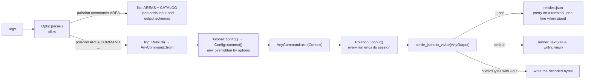
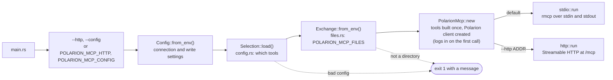
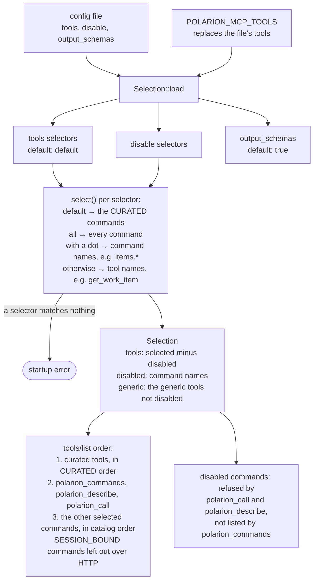
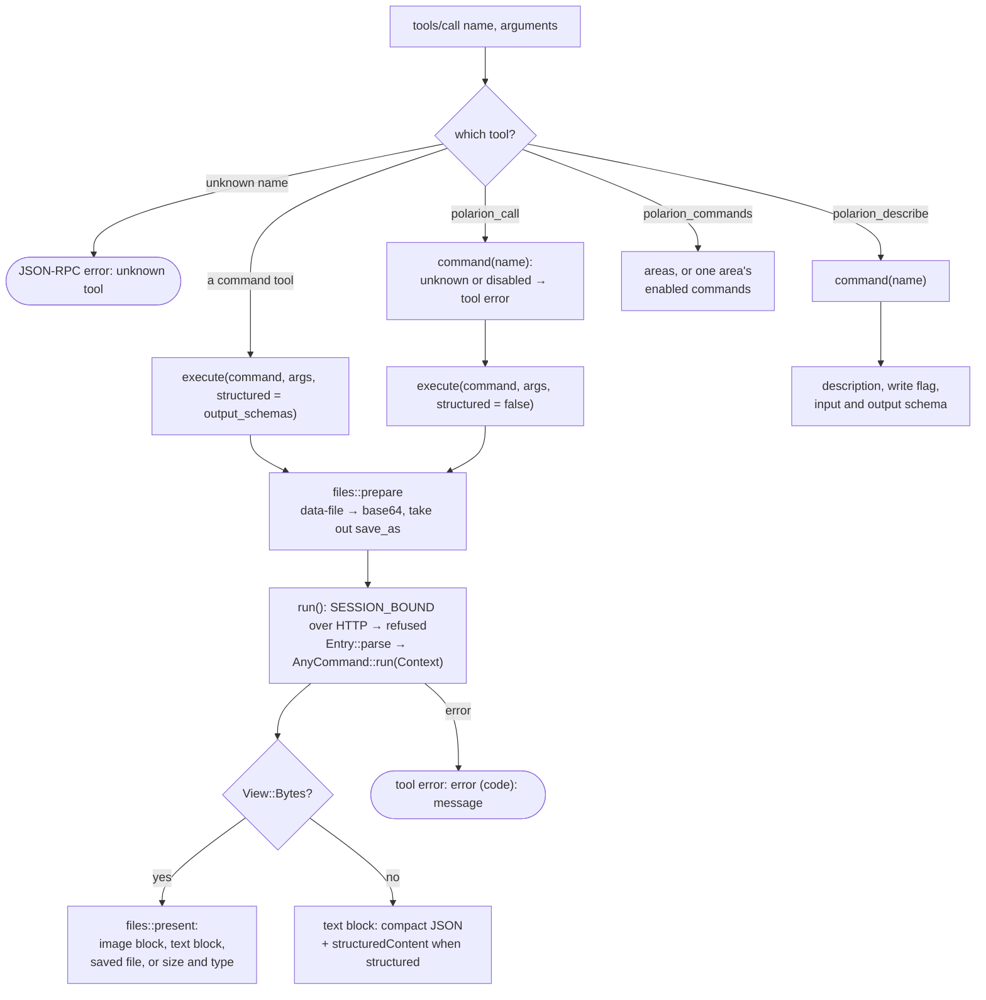
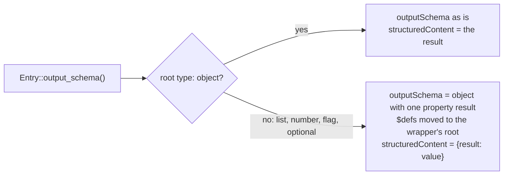
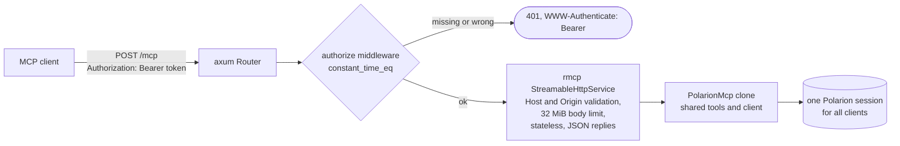

# Front ends (`polarion-cli`, `polarion-mcp`)

Both binaries are thin. They turn their input into an `AnyCommand`, connect with the settings from the environment
(`polarion_commands::Config`), run the command, and present the serialized result. Neither contains Polarion logic:
the command tree and the tools come from the catalog (see [Commands](commands.md)).

## CLI

- **The command tree:** [`cli.rs`](../crates/polarion-cli/src/cli.rs) has two top-level variants. `Top::Commands`
  lists commands, and `Top::Run` flattens the generated `polarion_commands::Cli` tree into the top level, so
  `polarion items get MP-42` is the `ItemsCli::Get` variant. Global options (`--url`, `-p`, `--json`, `--out`,
  `--write-projects`, ...) are in `Global` and override the environment.
- **Output:** JSON output is the library's serde form, unchanged. Text output in
  [`render.rs`](../crates/polarion-cli/src/render.rs) follows the command's `View`:
  - `Table(columns)`: a table with the given columns
  - `Object`: an indented `key: value` tree
  - `Lines`, `Links`, `Scalar`: one value per line, outgoing and incoming links, a single value
  - `Bytes`: a size summary, or the file written with `--out`
  - `Done`: nothing, or whether something changed

  Rich text is shown with its HTML tags stripped.
- **Errors:** errors go to stderr, as `{"error": {"code", "message"}}` with `--json`. The exit code comes from
  `CommandError::exit_code`: 1 error, 2 usage error, 3 not found.

## MCP server

### Startup

`PolarionMcp` is an rmcp `ServerHandler` whose tools are built at run time from the catalog (no `#[tool]` macros),
in [`server.rs`](../crates/polarion-mcp/src/server.rs). Its state (tools, client, settings) sits behind an `Arc`,
so the clones rmcp makes, one per HTTP request, share it.

### Which tools exist

[`config.rs`](../crates/polarion-mcp/src/config.rs) resolves the optional TOML file and `POLARION_MCP_TOOLS` into
a `Selection`:

- **Tool names:** each command gets one tool. The 15 everyday reads in `CURATED` keep their names
  (`get_work_item`); every other command is `area_command` (`items_add_link`). A selector matches a command by
  either name.
- **Disabled means disabled:** a disabled command is gone from every tool, so `disable` works as a deny list, not
  just a shorter tool list.

### Calling a tool

- **Errors:** failures of a command, including refused writes, are tool results with `isError`, so the agent can
  read and react to them. Only an unknown tool name is a protocol error.
- **Files:** bytes never reach the agent as base64. [`files.rs`](../crates/polarion-mcp/src/files.rs) sniffs the
  type from the first bytes: images up to 4 MB become image blocks, UTF-8 text up to 100 KB a text block,
  anything else a size-and-type summary. With an exchange folder (`POLARION_MCP_FILES`), `save_as` writes the
  file there, and every byte argument `x` gets an `x-file` alternative that reads one. Only plain file names are
  accepted: no paths, no `..`, no symbolic links.

### Output schemas

Command tools declare an `outputSchema` from `Entry::output_schema()`, unless the command returns nothing
(`View::Done`) or bytes (`View::Bytes`), or `output_schemas = false`:

MCP 2025-06-18 and 2025-11-25 require an object at the root of `outputSchema` and of `structuredContent`, and
clients built for them reject anything else. So non-object results are wrapped for every protocol version.
`polarion_call` returns text only, since its result type depends on the command; `polarion_describe` shows the raw
output schema instead.

### HTTP

- **Access:** [`http.rs`](../crates/polarion-mcp/src/http.rs) puts a bearer-token check
  (`POLARION_MCP_AUTH_TOKEN`, at least 16 characters, compared in constant time) in front of rmcp's service.
  rmcp checks `Host` against `POLARION_MCP_ALLOWED_HOSTS` (default: localhost names) and refuses browser `Origin`s
  that are not in `POLARION_MCP_ALLOWED_ORIGINS`, which protects against DNS rebinding.
- **Stateless:** no `Mcp-Session-Id` and no server-initiated streams; every POST gets a JSON reply. That keeps the
  server free of per-client state.
- **One identity:** all clients act as the server's Polarion account and share its session. Transactions would
  mix clients' changes, so `SESSION_BOUND` commands are left out of the tool list and refused by `run()` over
  HTTP.
- **Shutdown:** Ctrl-C or SIGTERM cancels rmcp's token, axum shuts down gracefully, and `PolarionMcp::shutdown`
  ends the Polarion session. Over stdio, the session ends when stdin closes.
