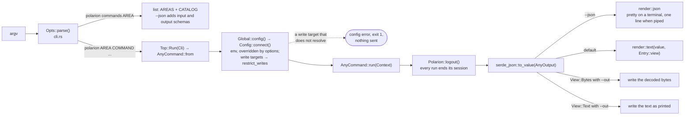
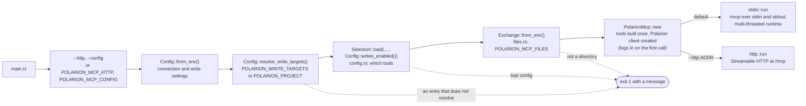
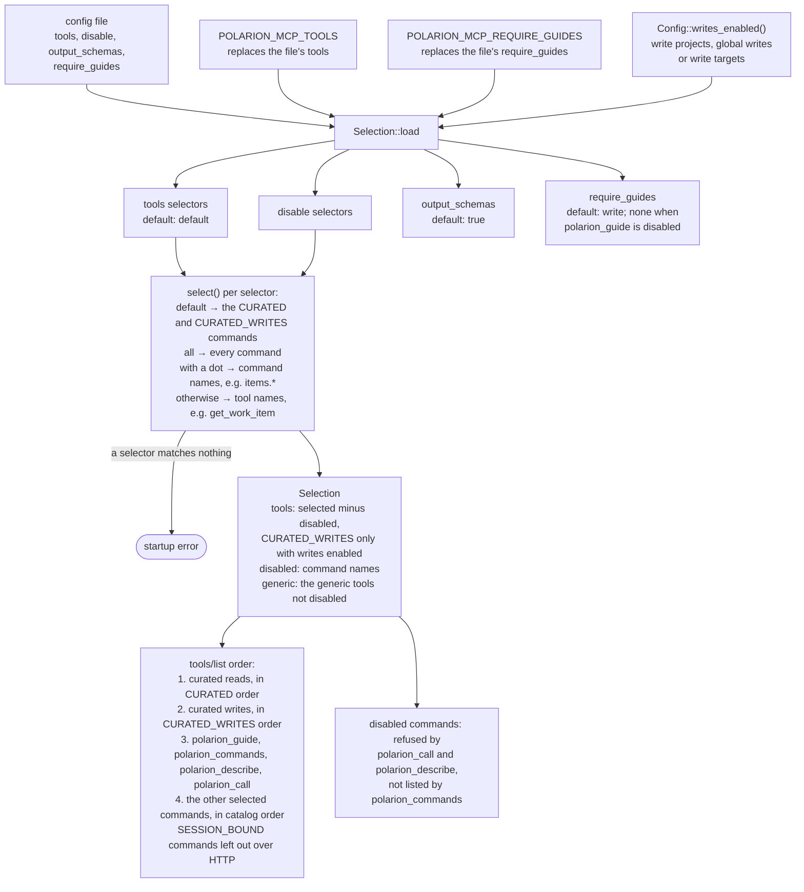
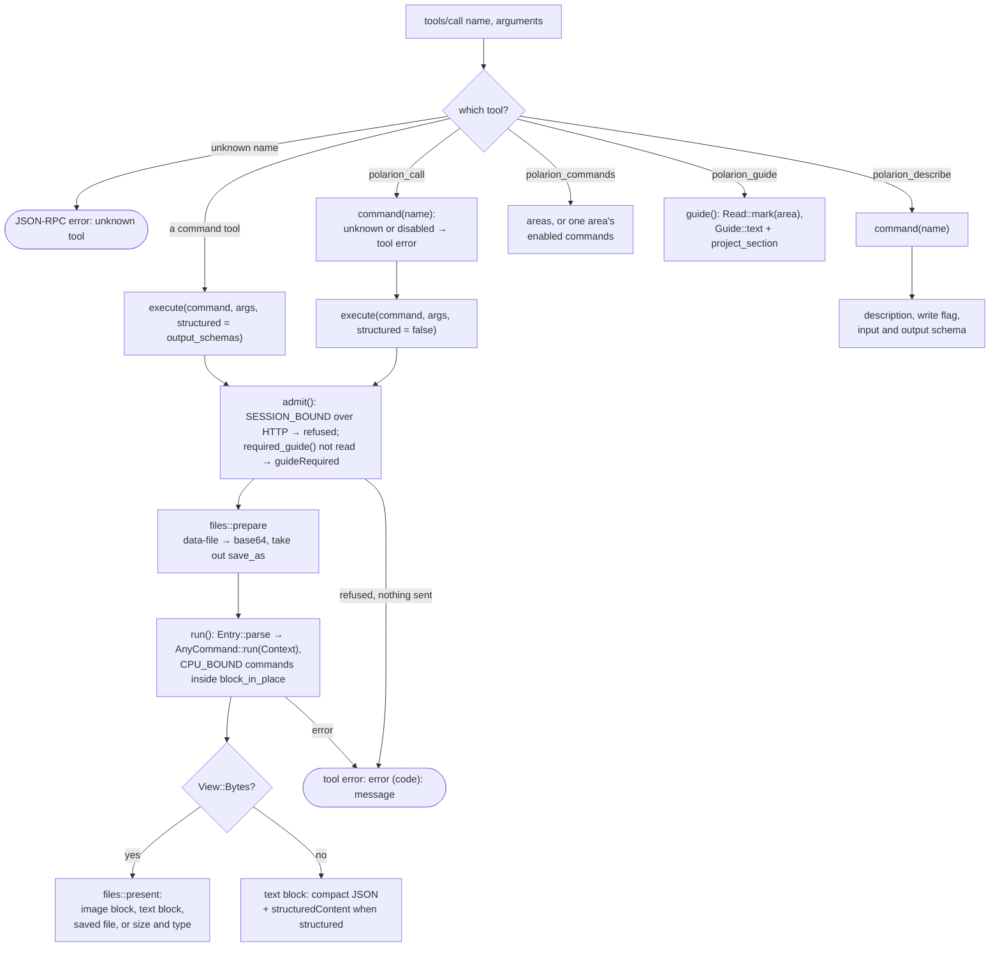
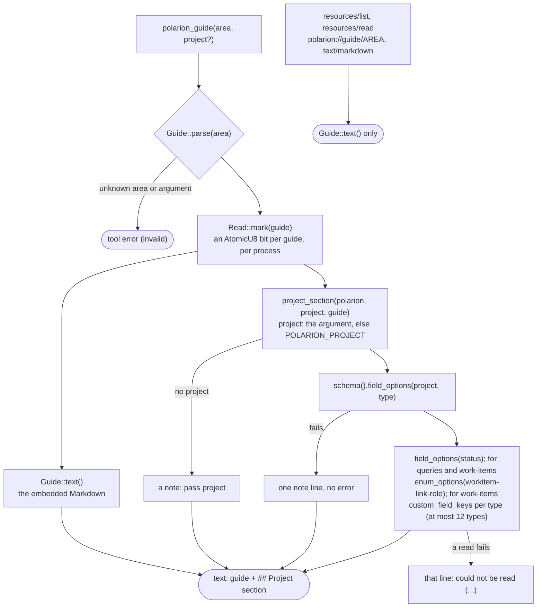
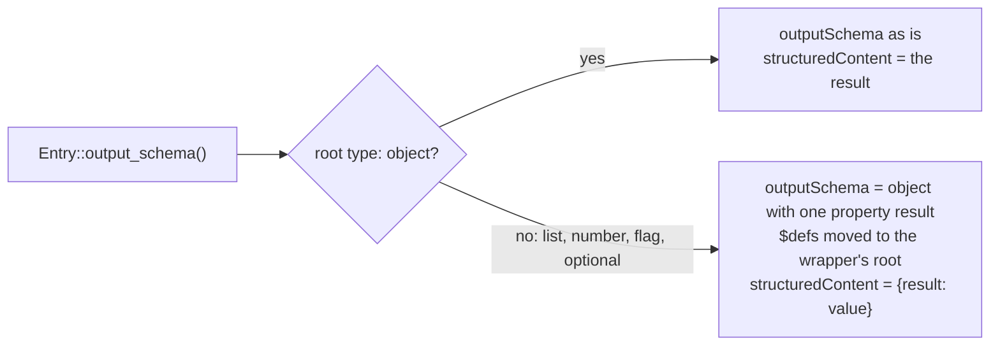

# Front ends (`polarion-cli`, `polarion-mcp`)

Both binaries are thin. They turn their input into an `AnyCommand`, connect with the settings from the environment
(`polarion_commands::Config`), run the command, and present the serialized result. Neither contains Polarion logic:
the command tree and the tools come from the catalog (see [Commands](commands.md)).

## CLI

- **The command tree:** [`cli.rs`](../crates/polarion-cli/src/cli.rs) has two top-level variants. `Top::Commands`
  lists commands, and `Top::Run` flattens the generated `polarion_commands::Cli` tree into the top level, so
  `polarion items get MP-42` is the `ItemsCli::Get` variant. Global options (`--url`, `-p`, `--json`, `--out`,
  `--write-projects`, ...) are in `Global` and override the environment.
- **Write targets:** `POLARION_WRITE_TARGETS` restricts writes to the objects it lists (set, even empty, it wins
  over `POLARION_WRITE_PROJECTS` and `POLARION_ALLOW_GLOBAL_WRITES`; never any creates). `Config::from_env` reads
  it (clap does not), splits it with `split_targets` (`\,` is a comma inside a name) and resolves entries without
  a project in `POLARION_PROJECT` from the environment (`Config::write_targets_project`), so `-p` changes the
  default project of the commands but never what may be written. `--write-targets` overrides the variable and is
  resolved in the project of `-p`. `Config::connect` resolves the entries (`Config::resolve_write_targets`,
  `WriteTarget::parse`: `PREFIX-NUMBER`, `PROJECT/ID`, `doc:`, `run:`, URIs; anything else is a `config` error
  before anything is sent) and passes their URIs to `PolarionBuilder::restrict_writes`, never a create budget (see
  [the write guard](library.md#the-write-guard)). An empty `-p` or `POLARION_PROJECT` is no project, and a
  `POLARION_WRITE_TARGETS` that is not Unicode is a `config` error.
- **Output:** JSON output is the library's serde form, unchanged. Text output in
  [`render.rs`](../crates/polarion-cli/src/render.rs) follows the command's `View`:
  - `Table(columns)`: a table with the given columns
  - `Object`: an indented `key: value` tree
  - `Lines`, `Links`, `Scalar`: one value per line, outgoing and incoming links, a single value on one line
  - `Text`: the string as it is (Markdown), ending with one line break, or the file written with `--out`; empty
    text is printed as nothing, without the "no results" note
  - `Bytes`: a size summary, or the file written with `--out`
  - `Done`: nothing, or whether something changed

  Rich text is shown with its HTML tags stripped. A list of texts that contain commas (warnings) gets one `- `
  line per item instead of one comma-separated line.
- **Text arguments:** `TextArg` options (`--markdown`) take the text, `@FILE`, `@-` or `@@...`, and values that
  start with `-` (a Markdown list) are the value, not an option.
- **Errors:** errors go to stderr, as `{"error": {"code", "message"}}` with `--json`. The exit code comes from
  `CommandError::exit_code`: 1 error, 2 usage error, 3 not found.

## MCP server

### Startup

`PolarionMcp` is an rmcp `ServerHandler` whose tools are built at run time from the catalog (no `#[tool]` macros),
in [`server.rs`](../crates/polarion-mcp/src/server.rs). Its state (tools, client, settings) sits behind an `Arc`,
so the clones rmcp makes, one per HTTP request, share it.

### Which tools exist

[`config.rs`](../crates/polarion-mcp/src/config.rs) resolves the optional TOML file and `POLARION_MCP_TOOLS` into
a `Selection`:

- **Tool names:** each command gets at most one tool. The 25 everyday reads in `CURATED` and the 19 everyday
  writes in `CURATED_WRITES` keep their names (`get_work_item`, `create_work_item`), also under `all`; every
  other command is `area_command` (`items_add_hyperlink`). A selector matches a command by either name. Both
  tables are grouped by area, so the list reads by area:

  | Area | Curated reads (`CURATED`) | Curated writes (`CURATED_WRITES`) |
  |---|---|---|
  | Work items | `get_work_item`, `query_work_items`, `count_work_items`, `work_item_links`, `work_item_history`, `get_work_item_description_markdown` | `create_work_item`, `update_work_item`, `set_work_item_description_markdown`, `append_work_item_description_markdown`, `add_work_item_comment`, `add_work_item_link`, `remove_work_item_link`, `add_work_item_attachment` |
  | Documents | `list_documents`, `get_document`, `document_work_items`, `search_documents`, `export_document_pdf` | `create_document`, `update_document`, `add_document_comment` |
  | Schema | `custom_fields`, `field_options` | |
  | Test runs | `search_test_runs`, `get_test_run`, `test_case_steps`, `test_run_records`, `test_run_report` | `create_test_run`, `update_test_run`, `add_test_record`, `set_test_steps` |
  | Plans | `search_plans`, `get_plan`, `plan_statistics` | `create_plan`, `update_plan`, `add_plan_items`, `remove_plan_items` |
  | Wiki | `query_wiki_pages`, `get_wiki_page` | |
  | Project, user | `get_project`, `get_user` | |

- **Curated writes:** the tools in `CURATED_WRITES` are listed exactly when the selection contains them
  (`default`, `all`, or by either name) and writes are enabled (`Config::writes_enabled`, passed to
  `Selection::load`). On a read-only server they have no tool at all, not even a generic one; `polarion_call`
  still reaches them, and the library refuses them. With writes enabled but some areas out of reach (global
  writes alone, or write targets of other kinds only), they are all listed and the library refuses those it
  cannot write; the instructions say which. Like every write tool they carry `readOnlyHint: false` and the
  "Modifies data" note of their command. The default list is 29 tools on a read-only server (25 reads, 4
  generic) and 48 with writes enabled (25 reads, 19 writes, 4 generic).
- **Disabled means disabled:** a disabled command is gone from every tool, so `disable` works as a deny list, not
  just a shorter tool list.

### Calling a tool

- **Errors:** failures of a command, including refused writes, are tool results with `isError`, so the agent can
  read and react to them. Only an unknown tool name is a protocol error.
- **Busy commands:** rmcp handles each request in a task of its own. The Markdown writes (`CPU_BOUND`) render
  mermaid diagrams on the calling thread, for up to seconds; on the multi-threaded runtimes of both transports
  they run inside `tokio::task::block_in_place`, so the runtime moves its other tasks (other requests, pings,
  cancellations) to another thread meanwhile. `run()` matches them by command name, so this holds for their
  curated tools and `polarion_call` alike.
- **Instructions:** the `initialize` instructions describe the generic tools that are listed, name the curated
  write tools that are listed, by area (`write_tool_instructions`), and name the Markdown commands only as far as
  they are offered: not disabled, reachable by a tool of their own or `polarion_call`, and the writes only when
  work items may be written (`markdown_instructions`). Both decide what may be written with `writable(kinds)`:
  each curated write changes one kind of object and may name others (`Kind::needed`: work item, document, test
  run or plan by its area, but `set_test_steps` writes a test case, a work item; `add_test_record` also names
  its test case and `add_plan_items`/`remove_plan_items` their work items), and kinds may be written with write
  projects, or when a write target of each kind exists (`Kind::of_target`; a URI by its object marker, so a plan
  target is its URI, `…${Plan}ID`). Global writes alone reach none of them. With write targets, creates are
  refused too (`tool_writable`: the library creates nothing in restricted mode). The refused tools are named: a
  whole area as "the document write tools" when all its listed tools are refused and one of them changes the
  area's own kind, otherwise single tools by name (`set_test_steps` alone with a test run as the only target;
  with targets of every kind, just the creates). A write target of the right kind is necessary, not enough:
  every object a write names must be a target too, which the sentence on the targets says.
- **Write targets:** `PolarionMcp::new` resolves `POLARION_WRITE_TARGETS` once, in `POLARION_PROJECT`, and builds
  the one client with them, so a command's `project` argument cannot move them; an entry that does not resolve
  stops the server at startup (`main.rs`). The instructions and the startup line of the HTTP
  transport (`access`) name the targets (`write_scope`), what is refused even for them (creates, deletes of whole
  objects, workflow actions, status and resolution changes, the body of a document with work items), that every
  object a write names must be a target, and that the server's own reactions (suspect links, notifications) are not
  prevented. Without a work item among the targets, the Markdown sentence offers only the read; the sentence
  on the curated write tools names those whose kind no target has (`writable`).
- **Files:** bytes never reach the agent as base64. [`files.rs`](../crates/polarion-mcp/src/files.rs) sniffs the
  type from the first bytes: images up to 4 MB become image blocks, UTF-8 text up to 100 KB a text block,
  anything else a size-and-type summary (so a PDF from `export_document_pdf` comes back as its size and type).
  With an exchange folder (`POLARION_MCP_FILES`), `save_as` writes the file there, and every byte argument `x` gets an `x-file` alternative that reads one. Only plain file names are
  accepted: no paths, no `..`, no symbolic links.

### Guides

[`guides.rs`](../crates/polarion-mcp/src/guides.rs) embeds one Markdown guide per area from
[`crates/polarion-mcp/guides/`](../crates/polarion-mcp/guides) (`include_str!`): `overview` (the tools, references,
results, write scope and restricted mode, errors), `queries` (the Lucene syntax, sorting, limits, fields),
`work-items`, `documents`, `tests`, `plans` and `wiki`. They state what this repository knows about Polarion (the
code, these docs, the live-suite findings in the README), nothing more.

- **Project section:** hidden options are left out, lists stop after 40 entries and custom field keys after 30
  per type. The reads are the library's schema reads, through the server's one client, so they go to the same
  server as everything else and are never writes. A failing read gives a note line instead of an error.
- **Resources:** the server announces the resources capability; `resources/list` names the seven guides
  (`polarion://guide/<area>`, `text/markdown`, with their size) and `resources/read` returns the static text,
  without the project section. Reading a resource does not count as reading the guide for the gate.
- **The gate:** `require_guides` (config file) or `POLARION_MCP_REQUIRE_GUIDES` (wins over the file) is
  `RequireGuides::Write` (default), `All` or `None`. `admit()` (in `execute`, so for curated tools, generic tools and
  `polarion_call` alike, by the command called) refuses a command whose guide was not read yet:

  | `require_guides` | refused until the area's guide was read |
  |---|---|
  | `write` | commands with the catalog's write flag, when anything may be written (`write_scope` is not read-only); on a read-only server the library refuses the writes anyway |
  | `all` | every command |
  | `none` | nothing |

  `Guide::of_area` maps the command areas: `items` → `work-items`, `documents`, `tests`, `plans` and `wiki` by name,
  every other area → `overview`; `queries` is never required. The refusal is a tool error
  `error (guideRequired): ...` naming the area, sent before anything reaches Polarion. The gate comes on top of the
  library's write guard, which checks every write that passes it. `polarion_commands` and `polarion_describe` are
  never gated.
- **State:** the guides read are kept in `Shared::read`, once per server process. Over stdio that is one client.
  Over HTTP the server is stateless and all clients share one Polarion session, so all clients share the guides
  read too: once one client read an area's guide, every client passes the gate for it (the instructions say "on
  this server (by any of its clients)").
- **Without the tool:** disabling `polarion_guide` turns the default gate off; asking for `write` or `all` with the
  tool disabled stops the server at startup. A `require_guides` value other than `write`, `all` or `none` stops
  it too.
- **Instructions:** `guide_instructions` asks the agent to read `polarion_guide(area)` before using an area's tools
  and says what is refused until then; with the gate off (or nothing to write) it is a hint.

### Output schemas

Command tools declare an `outputSchema` from `Entry::output_schema()`, unless the command returns nothing
(`View::Done`) or bytes (`View::Bytes`), or `output_schemas = false`:

MCP 2025-06-18 and 2025-11-25 require an object at the root of `outputSchema` and of `structuredContent`, and
clients built for them reject anything else. So non-object results are wrapped for every protocol version.
`polarion_call` returns text only, since its result type depends on the command; `polarion_describe` shows the raw
output schema instead.

### HTTP

- **Access:** [`http.rs`](../crates/polarion-mcp/src/http.rs) puts a bearer-token check
  (`POLARION_MCP_AUTH_TOKEN`, at least 16 characters, compared in constant time) in front of rmcp's service.
  rmcp checks `Host` against `POLARION_MCP_ALLOWED_HOSTS` (default: localhost names) and refuses browser `Origin`s
  that are not in `POLARION_MCP_ALLOWED_ORIGINS`, which protects against DNS rebinding.
- **Stateless:** no `Mcp-Session-Id` and no server-initiated streams; every POST gets a JSON reply. That keeps the
  server free of per-client state; the guides read for the gate are kept per process, for all clients
  together (see [Guides](#guides)).
- **One identity:** all clients act as the server's Polarion account and share its session. Transactions would
  mix clients' changes, so `SESSION_BOUND` commands are left out of the tool list and refused by `run()` over
  HTTP.
- **Shutdown:** Ctrl-C or SIGTERM cancels rmcp's token, axum shuts down gracefully, and `PolarionMcp::shutdown`
  ends the Polarion session. Over stdio, the session ends when stdin closes.
