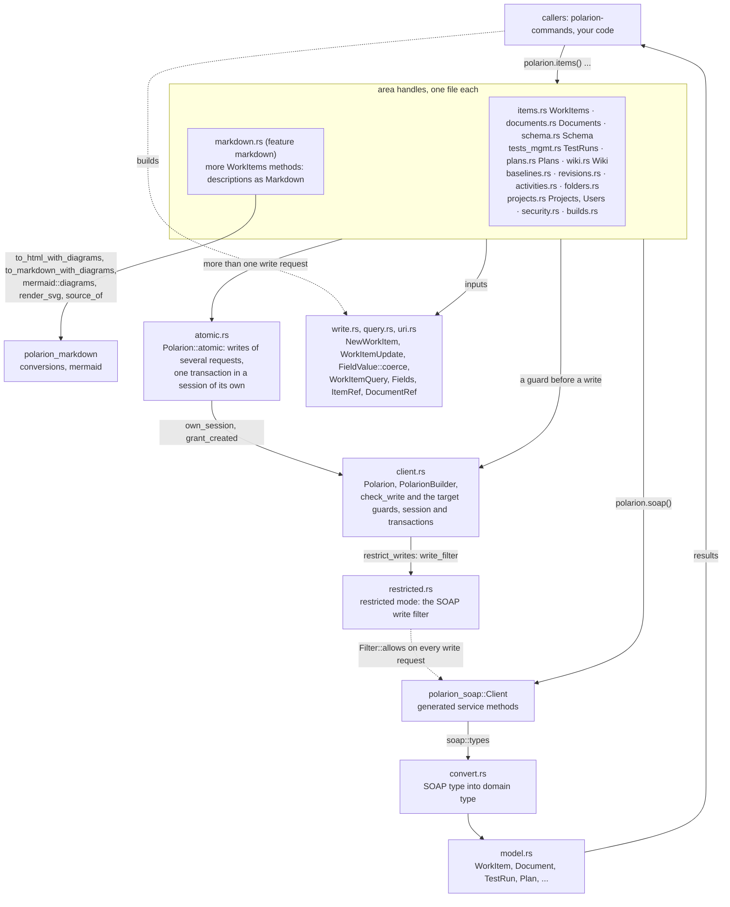
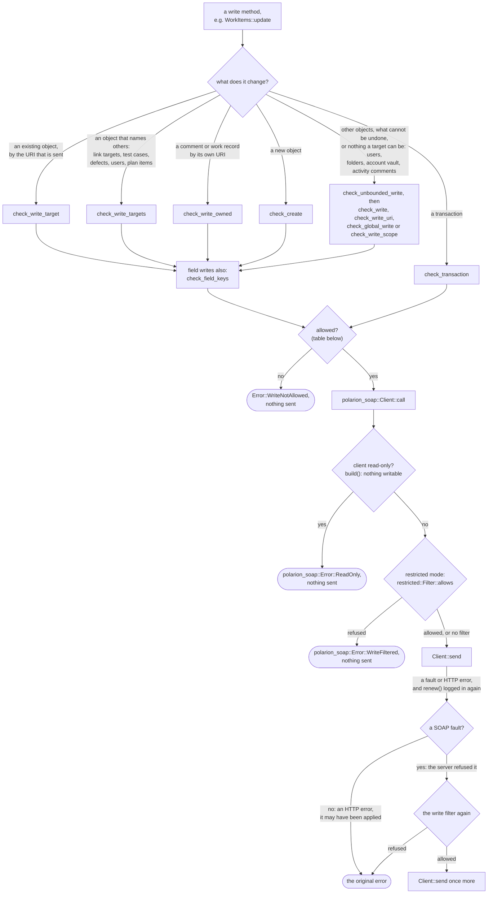
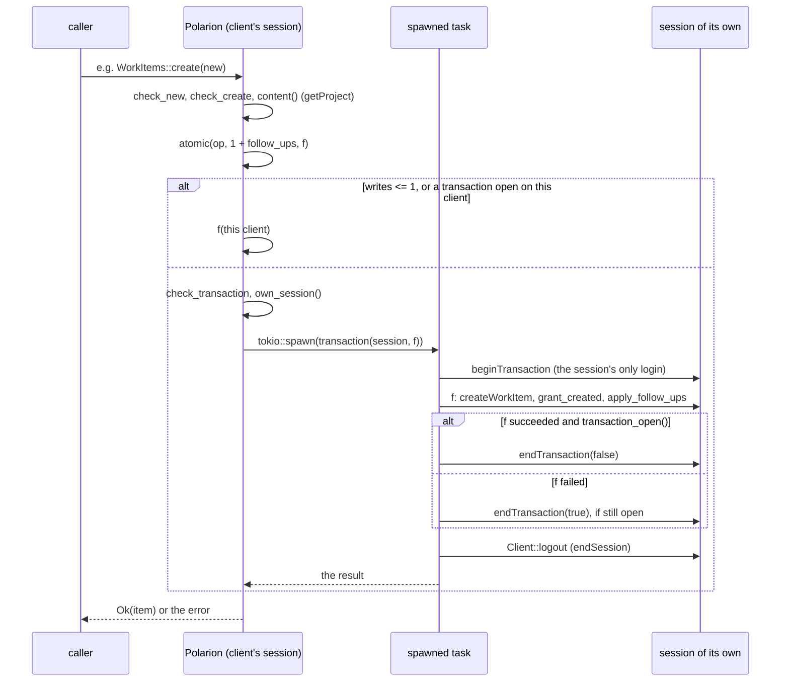

# Library (`polarion`)

The hand-written layer over `polarion-soap`. It groups the 302 SOAP operations by area and turns the generated SOAP
types into flat domain types that serialize to compact JSON. It also guards every write.

## Modules

- **`Polarion`** ([`client.rs`](../crates/polarion/src/client.rs)) holds the SOAP client and the write policy, and
  hands out one handle per area (`items()`, `documents()`, `tests()`, ...). Handles are small borrowed structs.
  Clones of `Polarion` share the session.
- **Handles** ([`items.rs`](../crates/polarion/src/items.rs), ...) map one library method to one or more SOAP
  operations. Variants of an operation (`…WithFields`, `…Limited`, `…InBaseline`, `…BySQL`) are options of one
  method, not separate methods.
- **Domain types** ([`model.rs`](../crates/polarion/src/model.rs)) are flat views of the SOAP types:
  - enum options, users and linked work items become their ids
  - custom fields become a `key → FieldValue` map
  - empty fields are left out of the JSON (camelCase)

  Configuration-like results (test configuration, licenses, builds, activities, folders) are returned as the
  generated SOAP types, which serialize with `polarion-soap`'s `serde` feature.
- **Conversions** ([`convert.rs`](../crates/polarion/src/convert.rs)) are `From` impls from SOAP types into domain
  types. They are the only place that knows both sides. Polarion answers a missing work item with an "unresolvable"
  item instead of a fault; the handles turn that into `Error::NotFound`.
- **References** ([`uri.rs`](../crates/polarion/src/uri.rs)): `ItemRef` and `DocumentRef` hold a project and id
  (or space and name) and/or the object URI. They are parsed from URIs on a best-effort basis: the raw URI is always
  kept, and a URI in an unknown format leaves the parts empty instead of failing.
- **Markdown** ([`markdown.rs`](../crates/polarion/src/markdown.rs), feature `markdown`; `mermaid` renders
  diagrams, `highlight` highlights code): `description_markdown`, `set_description_markdown` and
  `append_description_markdown` on `WorkItems`, with `MarkdownReadOptions`, `MarkdownWriteOptions` and the result
  `MarkdownUpdate`; `description_markdown_export` returns the Markdown with the images it shows (`MarkdownExport`),
  and `MarkdownWriteOptions::images` (`LocalImage`: source, file name, bytes) attaches images. The library reads
  and writes no file: the commands do ([`files.rs`](../crates/polarion-commands/src/files.rs)). A top-level file of its own, so the commands' coverage test sees its methods. The writes call
  `WorkItems::writable` before anything else, render every new diagram before the first upload, upload before
  `updateWorkItem`, and delete only the diagram attachments the old description showed (see
  [Markdown](markdown.md)). The reads and the rendering come first (`write_markdown`); then two steps through
  `Polarion::atomic`: the uploads, and after them the update and the deletes (`Plan::execute`). Each step of more
  than one write is one transaction. Two steps, because Polarion lists an attachment uploaded in a transaction only
  once it is committed (seen on a live server), and the HTML needs the new attachments' ids, read in between.
  `polarion_markdown` is re-exported.
- **Write inputs** ([`write.rs`](../crates/polarion/src/write.rs)): `NewWorkItem`, `WorkItemUpdate`,
  `NewDocument`, `NewTestRun`, `NewPlan`, ... The create inputs also carry what their create request cannot:
  categories, assignees, links and the other follow-ups of a work item (`NewWorkItem::follow_ups`), the type,
  status and custom fields of a document (`NewDocument::follow_up`), the `fields` of a test run or plan. `FieldValue::coerce(json, definition)` types JSON from a CLI or an agent for a custom field,
  using the field's definition from `schema()`.

## The write guard

Writes are refused unless they are enabled for what they change, in two layers: every library write method calls a
guard in [`client.rs`](../crates/polarion/src/client.rs) before it sends anything, and the SOAP client underneath
refuses what the client may not send. A client is in one of two modes:
- **Project mode**, the default. `Polarion::new` and `Polarion::from_client` allow no writes.
  `PolarionBuilder::allow_writes(["Sandbox"])` allows writes to objects in the listed projects, and
  `allow_global_writes(true)` writes that belong to no project.
- **Restricted mode**, with `PolarionBuilder::restrict_writes(uris)` (the objects that may be written, by URI) and
  `allow_creates(project, CreateBudget)` (how many work items, test runs and documents may be created, in one
  project). It is fail-closed: on as soon as either was called, even with nothing in it, and `allow_writes` and
  `allow_global_writes` cannot widen it.

`Polarion::write_allowed(uri)` answers the guard's question for an object without sending anything;
`writes_restricted()` and `write_targets()` show the mode. The path of a write:

What each guard allows:

| Guard | Used by | Project mode | Restricted mode |
|---|---|---|---|
| `check_write_target(op, uri)` | `WorkItems::writable` (every other write to an existing work item, comments and Markdown included), `Documents::writable`, `TestRuns::writable_run`, `Plans::writable`, `TestRuns::set_steps` (the test case), `Baselines::update` | the project of `uri` is writable | `uri` (without `%revision`) is a target |
| `check_write_targets(op, uri, named)` | `add_link`, `add_link_at_revision`, `remove_link`, test records (`TestRuns::writable_record`: test case, defect, executing user), `TestRuns::update` (summary defect), `Plans::add_items`/`remove_items` | the project of `uri` (links may point to other projects) | `uri` and every named object are targets |
| `check_write_owned(op, owner, owned)` | replies to comments, `set_comment_resolved`, `set_comment_tags`, `delete_work_record` | the projects of both URIs are writable | `owner` is a target, and `uri::owner_of(owned)` reads that owner (an unknown format is refused) |
| `check_create(op, project, kind)` | `WorkItems::create`, `Documents::create`, `TestRuns::create` | `project` is writable | `project` is the budget's, and its kind has a create left; every attempt takes one, even if it fails later (or rolls back) |
| `check_unbounded_write(op)` | workflow actions, deletes of whole objects, moves, reuse and derived documents, title headings, test executions, summary defects, project spans, external, OSLC and revision links, auto-suspect, auto-assign, document comments that refer to a work item, other creates (`create_module`, work items in a document, plans, baselines, folders, users), user updates, the account vault, activity comments | passes; the project check that follows decides | refused |
| `check_write`, `check_write_uri`, `check_global_write`, `check_write_scope`, `check_any_write` | after `check_unbounded_write`; inside the target guards and `check_transaction` in project mode | the project is in `allow_writes`; writes that belong to no project need `allow_global_writes` | refused, so a method that calls only these is refused too |
| `check_field_keys(op, keys)` | field writes: creating and updating work items, `set_custom_field`, `clear_fields`, updating documents, test runs and plans | nothing to check | never `status` or `resolution` (any case) |
| `check_transaction(op)` | `begin_transaction`, `commit`, `rollback`, `Polarion::atomic` | as `check_any_write` | allowed when the client has a target or a create left: transactions only wrap writes that are checked one by one |

**Documents** in restricted mode: `Documents::update` never writes the structure link role, never a body with work
item macros (`module-workitem`), and the body or outline numbering only of a document that holds no work items. It
reads them first (`getModuleWorkItemUris`) and leaves an approval (`Polarion::approve_document_write`) that the
filter uses up with the next request that writes that document's body or outline numbering, also when it refuses
the request. The read and the write are separate requests: a work item added to the document in between is not
seen.

**Objects a session of its own created** (restricted mode): a create with follow-ups runs in a session of its own
(`Polarion::own_session`, see [below](#writes-of-several-requests)), whose guard and filter also accept the objects
that session created (`Polarion::grant_created`, kept in its `restricted::Created`; the filter checks them with
`Filter::is_writable`, in its `Target` and `Owned` classes only). The URI the server returns must be an object of
that kind in the budget's project, without a revision; otherwise the transaction rolls back. Neither the client's
own session nor another session of its own may write to such an object, and `write_allowed` stays false for it.
Before the budget is taken, the create's follow-ups are checked (`WorkItems::check_new`): link targets and plans
must be targets; external, OSLC and revision links, and any follow-up while an explicit transaction is open
(`OWN_SESSION`), are refused.

**The SOAP write filter** ([`restricted.rs`](../crates/polarion/src/restricted.rs)) is installed by
`PolarionBuilder::build()` in restricted mode (`ClientBuilder::write_filter`; the SOAP client is read-only too when
there is no target and no create). `polarion_soap::Client::call` asks it about every write request before it is
sent, also those made through `Polarion::soap()`. It parses the request (roxmltree) and refuses: an operation that
is not in its `OPERATIONS` table (each row: the operation, its `Class` and `Subject`, its parameters in order);
markup the request writer never emits (comments, CDATA, document types, processing instructions), unknown
namespaces, unknown, repeated or reordered parameters and repeated fields; a request whose object (the `Subject`:
the first parameter, the `uri` of the updated object, a custom field's `parentItemURI`) is missing or no target, or
that names any object URI (a whole text or attribute value) that is not a target, an object owned by the target, or
a budgeted create's project; identity fields in an updated object; `status` and `resolution`; document link
settings and work item macros; a document body or outline numbering without the library's approval. It counts
creates on its own, so at most the budget's number of create requests is sent. The table test in
`tests/write_targets.rs` (`every_write_operation_is_classified`) classifies every write operation of the generated
services: allowed (in `OPERATIONS` and in `ALLOWED`, with the same class) or never sent (`NEVER`, with the reason).
An operation from a newer WSDL fails it until it is classified, and
`the_filter_knows_the_parameters_of_its_operations` compares the parameters with the generated services.

**Replay after a session renewal** (`polarion_soap::Client::call`, see
[SOAP client](soap-client.md#renewal-after-expiry)): a read is repeated after a fault or an HTTP error once the
session was renewed. A write is repeated only after a SOAP fault (the server answered and refused it), never after
an HTTP error (it may have been applied), and only when it passes the write filter again, so a create beyond the
budget or a document body without a new approval is not repeated. Inside an explicit transaction nothing is
repeated (`polarion_soap::Error::SessionExpired`).

- **Every method that modifies data must call a guard first**: a target guard (`check_write_target`,
  `check_write_targets`, `check_write_owned`, `check_create`), or `check_unbounded_write` followed by the project
  check (`check_write`, `check_write_uri`, `check_global_write`, `check_write_scope`). That is a rule for
  contributors; `tests/items_write.rs`, `tests/areas.rs` and `tests/write_targets.rs` check it against a mock
  server: refused writes must not send a request.
- `Polarion::soap()` returns the raw SOAP client, which bypasses the guards. It is read-only when no writes are
  enabled at all, and filtered in restricted mode.
- **What restricted mode does not prevent:** what the server does in response to a write to a target. Changing a
  work item can mark links from other work items to it as suspect, and notification rules may email people.
- The front ends map their settings onto the builder: `POLARION_WRITE_PROJECTS` → `allow_writes`,
  `POLARION_ALLOW_GLOBAL_WRITES` → `allow_global_writes`, and `POLARION_WRITE_TARGETS` (which wins over both, even
  when empty) → `restrict_writes` with the resolved URIs, never a create budget (in
  [`polarion-commands/src/config.rs`](../crates/polarion-commands/src/config.rs), `Config::connect`).

## Writes of several requests

A library operation that needs more than one SOAP write sends them through `Polarion::atomic`
([`atomic.rs`](../crates/polarion/src/atomic.rs)): a create with follow-ups (`WorkItems::create`,
`create_in_document`, `Documents::create`, `create_module`, `TestRuns::create`, `Plans::create`), `WorkItems::update`
with more than one request, and the Markdown description writes: their uploads, then their update and deletes. The guards, conversions and
reads run first, on the client; one write alone, or a write inside the client's open transaction (an explicit one,
or the transaction of a session of its own calling further methods), runs on the client as before.

- **A session of its own** (`Polarion::own_session`): a SOAP client built from the template the builder kept
  (`Sessions`), with its own reqwest client and cookie jar, so it shares nothing with the client's session. It is
  transaction-only (`ClientBuilder::transaction_only`): it logs in once (a renewal is `SessionExpired`) and sends no
  write outside its transaction (`NoTransaction`). It shares the write policy and the SOAP write filter with the
  client, so budgets stay single. The polarion-mcp HTTP server can therefore run these commands although all its
  clients share one session.
- **All or nothing:** a failed write or a follow-up that adds nothing (`Invalid`) rolls back; a commit the server
  refuses committed nothing (its fault is returned); a commit without an answer is `Error::CommitUncertain`; an
  expiry inside the transaction commits nothing (`SessionExpired`).
- **Cancellation:** the transaction runs in a spawned task, so a caller that is dropped (an MCP cancel, a timeout)
  does not stop it: it commits or rolls back and logs out, and the result is dropped. Rolling back from `Drop`
  instead could overtake a write still on its way, which would then be committed alone. When the runtime shuts down
  first, nothing is committed and the server times the session out. A panic in `f` is raised again in the caller.
- **Cost:** one more login and logout per such operation.

## Contracts

- **Whole API:** [`tests/coverage.rs`](../crates/polarion/tests/coverage.rs) fails when a generated SOAP operation
  is neither called somewhere in `src/` nor listed in its `EXCLUDED` table with a reason. A newer WSDL with new
  operations therefore needs library methods (or exclusions) before the tests pass again.
- **Output schemas:** with the `schemars` feature, the domain types derive `JsonSchema`. The derived schemas match
  the serialized JSON because both come from the same serde attributes. `ItemRef` and `DocumentRef` (hand-written
  `Serialize`) and `FieldValue` (untagged: any JSON value) have hand-written schemas. `polarion-commands`
  validates real values against them (see [Commands](commands.md#output-schemas)).
- **Writes are verified against a mock server first.** The live suite runs them against a real server, on its
  fixtures only (see [Testing](testing.md#the-live-suite-fixtures-on-a-real-server)); the assumptions that still
  need such a run are listed in the [README](../README.md#writes) ("Not yet verified").
