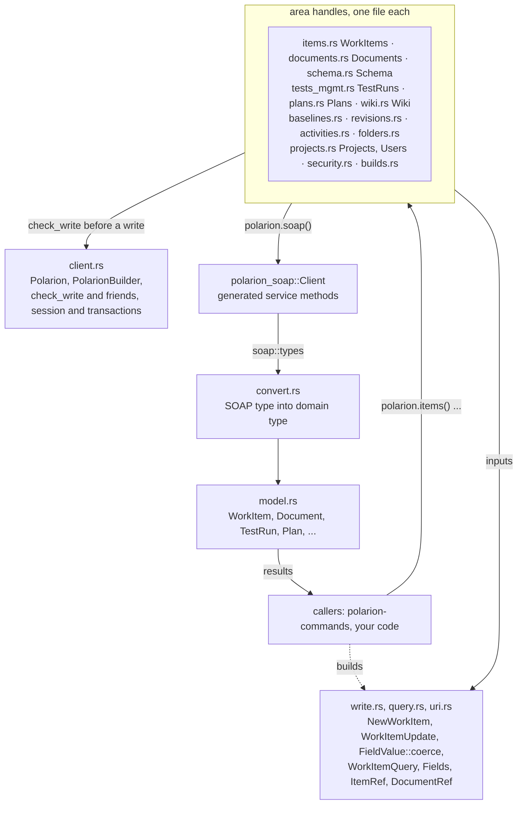
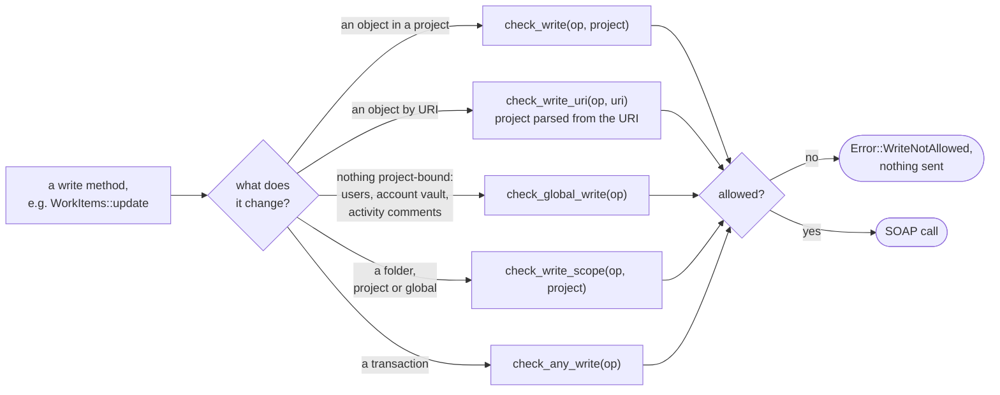
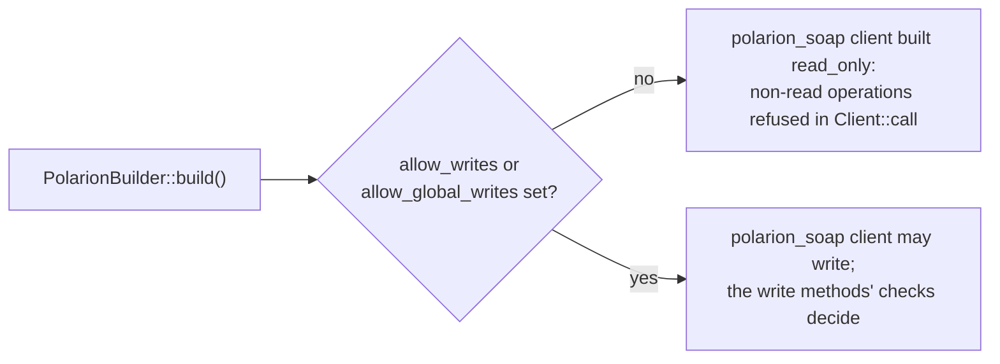

# Library (`polarion`)

The hand-written layer over `polarion-soap`. It groups the 302 SOAP operations by area and turns the generated SOAP
types into flat domain types that serialize to compact JSON. It also guards every write.

## Modules

- **`Polarion`** ([`client.rs`](../crates/polarion/src/client.rs)) holds the SOAP client and the write policy, and
  hands out one handle per area (`items()`, `documents()`, `tests()`, ...). Handles are small borrowed structs.
  Clones of `Polarion` share the session.
- **Handles** ([`items.rs`](../crates/polarion/src/items.rs), ...) map one library method to one or more SOAP
  operations. Variants of an operation (`…WithFields`, `…Limited`, `…InBaseline`, `…BySQL`) are options of one
  method, not separate methods.
- **Domain types** ([`model.rs`](../crates/polarion/src/model.rs)) are flat views of the SOAP types:
  - enum options, users and linked work items become their ids
  - custom fields become a `key → FieldValue` map
  - empty fields are left out of the JSON (camelCase)

  Configuration-like results (test configuration, licenses, builds, activities, folders) are returned as the
  generated SOAP types, which serialize with `polarion-soap`'s `serde` feature.
- **Conversions** ([`convert.rs`](../crates/polarion/src/convert.rs)) are `From` impls from SOAP types into domain
  types. They are the only place that knows both sides. Polarion answers a missing work item with an "unresolvable"
  item instead of a fault; the handles turn that into `Error::NotFound`.
- **References** ([`uri.rs`](../crates/polarion/src/uri.rs)): `ItemRef` and `DocumentRef` hold a project and id
  (or space and name) and/or the object URI. They are parsed from URIs on a best-effort basis: the raw URI is always
  kept, and a URI in an unknown format leaves the parts empty instead of failing.
- **Write inputs** ([`write.rs`](../crates/polarion/src/write.rs)): `NewWorkItem`, `WorkItemUpdate`,
  `NewDocument`, ... `FieldValue::coerce(json, definition)` types JSON from a CLI or an agent for a custom field,
  using the field's definition from `schema()`.

## The write guard

Writes are refused unless enabled for the target, in two independent layers. First, every library write method
checks its target before it sends anything:

Second, the SOAP client underneath is read-only whenever no writes are enabled at all, which also covers code that
bypasses the handles:

- `Polarion::new` and `Polarion::from_client` allow no writes. `PolarionBuilder::allow_writes(["Sandbox"])` allows
  writes to objects in the listed projects. `allow_global_writes(true)` allows writes that belong to no project.
- **Every method that modifies data must call one of the checks first.** That is a rule for contributors, and
  `tests/items_write.rs` and `tests/areas.rs` check it against a mock server: refused writes must not send a request.
- `Polarion::soap()` returns the raw SOAP client, which bypasses the guard. It is still read-only when no writes
  are enabled at all.
- The front ends map their settings onto the builder: `POLARION_WRITE_PROJECTS` → `allow_writes`,
  `POLARION_ALLOW_GLOBAL_WRITES` → `allow_global_writes` (in
  [`polarion-commands/src/config.rs`](../crates/polarion-commands/src/config.rs)).

## Contracts

- **Whole API:** [`tests/coverage.rs`](../crates/polarion/tests/coverage.rs) fails when a generated SOAP operation
  is neither called somewhere in `src/` nor listed in its `EXCLUDED` table with a reason. A newer WSDL with new
  operations therefore needs library methods (or exclusions) before the tests pass again.
- **Output schemas:** with the `schemars` feature, the domain types derive `JsonSchema`. The derived schemas match
  the serialized JSON because both come from the same serde attributes. `ItemRef` and `DocumentRef` (hand-written
  `Serialize`) and `FieldValue` (untagged: any JSON value) have hand-written schemas. `polarion-commands`
  validates real values against them (see [Commands](commands.md#output-schemas)).
- **Writes are verified against a mock server only.** The assumptions that still need a run against a real sandbox
  are listed in the [README](../README.md#writes) ("Not yet verified").
