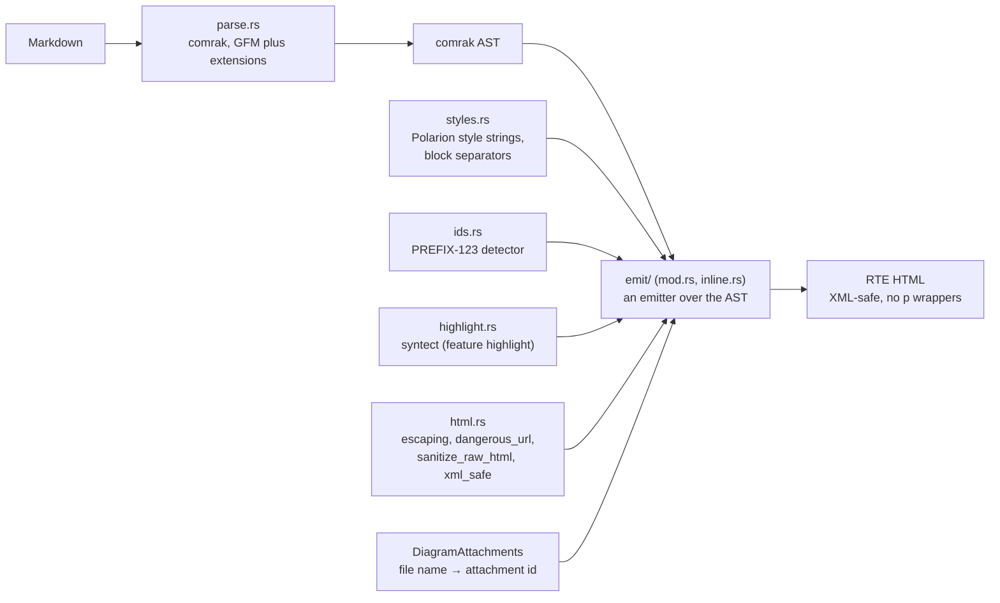
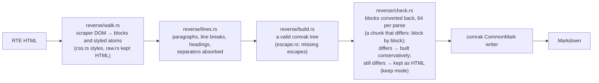
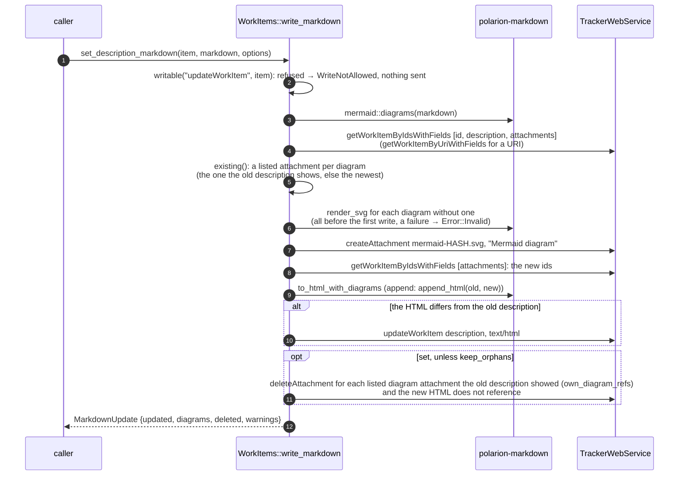
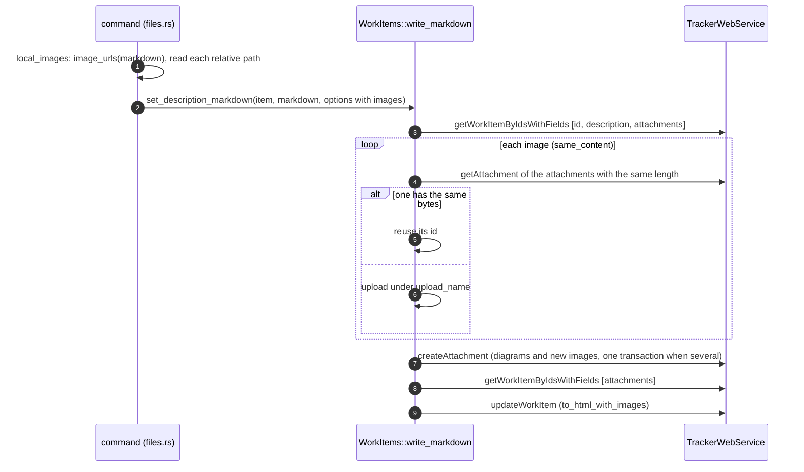
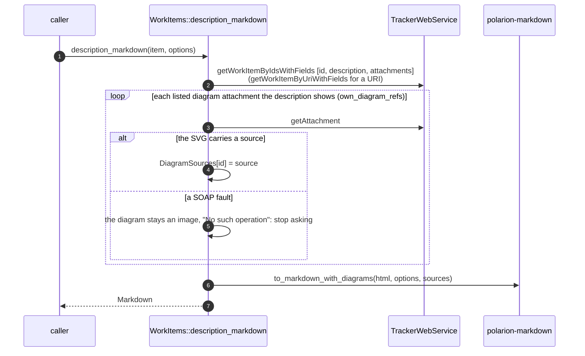

# Markdown descriptions (`polarion-markdown`, `polarion/src/markdown.rs`)

Work item descriptions are Polarion rich text: the inline-styled HTML of its rich text editor (RTE). Two layers
read and write them as Markdown:

- [`polarion-markdown`](../crates/polarion-markdown) converts, without I/O: Markdown to RTE HTML and back, mermaid
  diagrams to SVG and back.
- [`polarion/src/markdown.rs`](../crates/polarion/src/markdown.rs) (feature `markdown`) adds the requests:
  `WorkItems::description_markdown`, `set_description_markdown` and `append_description_markdown`, which keep each
  mermaid diagram as an SVG attachment of the work item, and `description_markdown_export`, which also returns the
  images a description shows.

The commands `items.description-markdown`, `items.set-description-markdown`,
`items.append-description-markdown` and `items.export-description` (and the MCP tool
`get_work_item_description_markdown`) call these methods.

## Markdown to HTML



`to_html(markdown, &ToHtmlOptions)` (or `to_html_with_diagrams` with known diagram attachments):

- Blocks are not wrapped in `<p>`. Two blocks of one container are separated as the RTE writes them
  (`styles::separator`, table below): two `<br/>`s after a paragraph or heading, one after a div, table, list,
  `<pre>` or `<hr/>`. Inside a list item there are none next to such a box, and there are none just inside a raw
  HTML wrapper.
- Headings are bold sized spans (22, 18, 14, 12, 11 and 10.5 pt, so all six levels come back), tables use
  Polarion's table class and styles, code blocks are a `<pre class="language-LANG">` (indented, Courier New).
  With the feature `highlight` and `ToHtmlOptions::highlight` (default on), code that names its language gets
  syntect's inline-styled spans (theme InspiredGitHub). Each document can spend 64 KiB of code and one second on
  highlighting. Code beyond that, code with a line longer than 512 bytes, unknown languages and mermaid blocks stay
  plain; only documents that hit the time limit can come out differently on another machine. Images are limited
  to 650 px.
- `PREFIX-123` ids become work item link spans as `ToHtmlOptions::work_items` says: `WorkItemIds::Any`,
  `Prefixes([...])` or `Off`. An id is an uppercase letter, at least one more uppercase letter, digit or `_`, a
  hyphen and digits, standing on its own (`ids.rs` is the one detector both directions use). `PROJ\-1` is not a link.
- `$…$` and `` $`…`$ `` are inline formula spans, while `$$…$$` and ```` ```math ```` blocks are display formulas
  (`data-inline="false"`). Task list items get ☐ / ☑. Alerts (`> [!NOTE]`, or a `:::note` directive) are styled
  blocks, and a directive of another name becomes a plain `<div>`. Footnotes follow a rule as `<sup>[n]</sup>`
  paragraphs, and a description list becomes bold terms with indented details.
- A mermaid block whose file name is in `DiagramAttachments` becomes ``; the others stay
  `<pre class="language-mermaid">` code blocks.
- Nesting deeper than 64 levels is written as escaped text.

| Markdown | Polarion HTML |
|---|---|
| `**x**`, `*x*`, `~~x~~`, `++x++`, `==x==` | a span with `font-weight: bold;`, `font-style: italic;`, `text-decoration: line-through;`, `text-decoration: underline;`, `background-color: #FFFF00;` |
| `^x^`, `~x~` | `<sup>`, `<sub>` |
| `` `x` `` | a span with `font-family: 'Courier New', Courier, monospace;` |
| `# …` to `###### …` | a bold span of 22, 18, 14, 12, 11, 10.5 pt |
| fenced code | `<pre class="language-X" style="margin-left: 40px; font-family: …">` (syntect spans with `highlight`) |
| `> quote` | `<div style="margin-left: 40px;">` |
| `> [!NOTE]` … | a div with a colored left border and a bold colored title span |
| table | `<table id="polarion_wiki macro name=table" class="polarion-Document-table">`, `th`/`td` styles with `text-align` |
| `- [ ]`, `- [x]` | `☐ `, `☑ ` prefixes |
| `[t](u)`, `` | `<a href target="_top" class="descriptionLink">`, `` |
| `MP-1` | `<span class="polarion-rte-link" data-type="workItem" … data-item-id="MP-1" data-option-id="long">` |
| `$x$`, `$$x$$` | `<span data-source="x" class="polarion-rte-formula">` (`data-inline="false"` for display) |
| `---` | `<hr/>` |

Separators (`styles::separator_breaks`, used by both directions; nothing before the first block of a container
or after the last):

| Between two blocks of one container | `<br/>`s |
|---|---|
| after a raw opening tag, before a raw closing tag | 0 |
| inside `<li>`: two text blocks | 2 |
| inside `<li>`: a box, opening or closing tag involved | 0 |
| after a text block (paragraph, heading, diagram image) | 2 |
| after a box (div, table, list, pre, hr, alert) or a raw closing tag | 1 |

## HTML to Markdown



`to_markdown(html, &ToMarkdownOptions)` (or `to_markdown_with_diagrams` with known diagram sources):

- Formatting Markdown cannot express (colors, other fonts and sizes, alignment, merged cells, ...) is kept as HTML
  with `RawHtml::Keep` (the default). That HTML is inline spans around the text, HTML blocks for tables, styled
  paragraphs and other block elements, and `<div …>`/`</div>` lines around the blocks of a styled div. Converting
  back restores the formatting, at the cost of verbose Markdown. `RawHtml::Drop` leaves that formatting out and
  keeps the text. A few things stay HTML in both modes because Markdown cannot hold them exactly: formulas (see
  below), links and images whose URL has a space, superscript in link text, emphasis whose delimiters would not
  work where they stand, line breaks in table cells (`<br/>`), and blocks the self-check rebuilt conservatively.
  For example, `Plain <span style="color: #FF0000;">red</span> text` stays as it is with `RawHtml::Keep` (writing
  it back restores the color) and becomes `Plain red text` with `RawHtml::Drop`.
- **Line breaks:** one `<br>` is a line break, written as a hard break (`\` at the line end); two or more end the
  paragraph. Around each block exactly the separator of the table above is absorbed. Extra `<br>`s become raw
  `<br/>` in keep mode and are dropped in drop mode. A single `<br>` ending a container is invisible and dropped.
  Whitespace collapses as in a browser; `&nbsp;` is kept.
- **Headings:** a line whose text is all at least 14pt, or more than 10pt and bold, is a heading. The level comes
  from its smallest size: ≥22 → 1, ≥18 → 2, ≥14 → 3, ≥12 → 4, ≥11 → 5, >10 → 6. `<h1>`–`<h6>` count as their
  heading's size. Table cells hold no headings.
- **Work item links** become the bare id where `work_items` would link it again. This covers a link span
  (`data-option-id="long"`, no scope or revision) and an anchor to `…workitem?id=ID` whose text is the id or that
  has no text. Where the id would not be linked again, keep mode keeps the span as HTML and drop mode writes the id
  as text; an anchor stays a Markdown link. Other Polarion link spans (short, pages, other projects, ...) stay HTML
  in keep mode. In drop mode they become their id, name, label or URL as text, or a link when they name only a
  `data-url`. Use the same `WorkItemIds` in both directions.
- **Escaping:** text is escaped so that it reads back as text. comrak's writer escapes Markdown characters
  (`snake\_case`, `\*`, `\#`, ...). `escape.rs` adds the escapes comrak lacks: `$` and `^`, runs of `=` or `+`, the
  `&` of `&#`, `www\.` and `https\://` outside link text, and a `|` that starts a line outside tables. Outside link
  text it also escapes the hyphen of every id-shaped token (`UTF\-8`, `PROJ\-1`) whatever `work_items` says, so
  plain text never becomes a work item link.
- **Formulas:** a formula span becomes `$…$`. Where `$…$` cannot hold it exactly (spaces at its edges, an unescaped
  `$`, a digit right after it, ...) it becomes `` $`…`$ ``. A display formula becomes `$$…$$`, or a fenced math
  block (```` ```math ````) when it is alone in its paragraph and has a line break or cannot be written `$$…$$`.
  Anything else stays the raw span in both modes: a line break in an inline formula, a display formula that is not
  alone and cannot be written `$$…$$`, a formula with a `|` in a table cell.
- **Tables** become GFM tables when the first row is all `th` and the others all `td`, no cell is merged, no row is
  wider than the header, the cells hold inline content only, only the forward direction's table and cell styles
  are used, and each column's cells share the header's alignment. Otherwise keep mode writes the table as an HTML
  block. Drop mode writes a GFM table with merged cells expanded into empty ones (up to 100,000 cells) and block
  content flattened to lines, the first row as the header. A `<br>` in a cell is a raw `<br/>`.
- **Lists:** `ul` and `ol` (with `start`); a `☐`, `☑` or `☒` prefix, or a checkbox `<input>`, makes a task item. A
  list is tight only when every item is a paragraph followed by nothing but lists; otherwise it is loose.
- **Code:** `pre` becomes a fenced code block. The language comes from a `language-x` or `lang-x` class, or from
  `data-lang`/`data-language`, on the `pre` or its `code`; highlighting spans are dropped. Older shapes read as
  code too: a monospace element with `<br>`s alone in an indent div, and a highlighter's wrapper div around a `pre`.
- **Diagrams:** an image of an attachment listed in `DiagramSources`, or a mermaid.ink image, becomes a mermaid
  block (```` ```mermaid ````), not inside a table cell or a link.
- **Self-check** (`check.rs`): the Markdown is parsed again and converted back (highlighting off) and compared with
  the HTML the built blocks stand for, 64 top-level blocks per parse; a chunk that differs is checked block by
  block. A block that differs is rebuilt conservatively: emphasis, links, superscript, subscript, images and linked
  ids as HTML, all ASCII punctuation escaped, lists loose. If that still differs, keep mode writes the block's
  intended HTML as an HTML block (lossless) and drop mode keeps the conservative version. A final check of the
  whole document backs this up. The result has no trailing newline.
- **Limits:** before parsing, tags nested deeper than 512 levels are left out and their text stays (parsing deep
  nesting takes quadratic time). Elements deeper than 64 levels become their text. Markdown nesting beyond 40 is
  flattened into the surrounding paragraphs; a quote level or an alert counts one, a list level two, a table
  three. Raw HTML nested deeper than 256 levels is written as its text. `colspan` and `rowspan` count at most 1000.

The conversion back is lossless on what the forward direction writes: the Markdown it gives converts to the same
HTML again, and canonical Markdown (as `to_markdown` writes it, see below) comes back unchanged. A change in
`emit/` needs the matching rule in `reverse/`, and both share the strings and the separator table in `styles.rs`.

## Mermaid diagrams

- **Names:** `mermaid::diagrams(markdown)` lists a document's mermaid blocks in order, each once. It skips empty
  blocks and blocks nested so deep that they are written as text. A diagram's file name is `mermaid-<hash>.svg`.
  The hash is the first 8 bytes of SHA-256 over `PROFILE` (`polarion-markdown/mermaid/1`), a line break and the
  normalized source, in hex. Normalizing makes line endings `\n`, replaces characters XML does not allow (a form
  feed by a space, the others by U+FFFD), strips trailing spaces and tabs, and drops the empty lines around the
  source. An unchanged diagram keeps its name, so it is neither rendered nor uploaded again. `PROFILE` changes only
  with the default theme or the embedding format, not with the renderer version, so an upgrade does not re-upload
  existing diagrams.
- **Metadata:** the SVG carries its source in
  `<metadata><mermaid xmlns="urn:polarion-rs:mermaid" version="1">SOURCE</mermaid></metadata>`; `source_of` finds
  it, which is how reading restores the block.
- **Rendering** (`mermaid::render_svg`, feature `mermaid`, mermaid-rs-renderer): size limits are checked before
  parsing (50,000 bytes, 1,000 lines, nesting in `%%{…}%%` directives and `$$` formulas, `&` lists, nodes in nested
  subgraphs or composite states). After parsing, flowcharts and class, state, ER and requirement diagrams may have
  at most 300 edges, because their routing time grows with the square of the edge count. A source over a limit
  fails with `MermaidError::TooLarge`. The renderer runs on a thread of its own with a 64 MiB stack, and a panic
  becomes `MermaidError::Panicked` (the panic hook still prints it). In the SVG, `javascript:` and similar links
  point to `#`. Event handler attributes, comments and every element the renderer does not write itself
  (`script`, `foreignObject`, HTML, …) are removed. The result must be well-formed XML, else
  `MermaidError::Invalid`. A `%%{init: {"theme": …}}%%` directive picks the theme. Layouts differ from mermaid.js.
- **Side effects:** text is measured with a system font, behind a mutex all renders of a process share. The first
  render of a process loads the system fonts (up to seconds) unless the font is in the renderer's cache,
  `$XDG_CACHE_HOME/mmdr/font-cache` (else `$HOME/.cache/mmdr/font-cache`). When it has to load them, it copies the
  font it uses there. With neither variable set there is no cache, and every process loads the system fonts again.
  The SVG depends on the installed fonts. Rendering is synchronous: milliseconds for a typical diagram, up to about
  15 s for a flowchart near the edge limit.
- **Older descriptions:** an image of a `https://mermaid.ink/img/…` or `…/svg/…` URL carries its source in base64,
  either plain text or the live editor's JSON. Reading turns it into a mermaid block too (`decode_mermaid_ink`),
  but not a compressed `pako:` payload.

## Setting a description

`set_description_markdown(item, markdown, &MarkdownWriteOptions)`, with a diagram the work item has no attachment
for yet:



A work item given by URI alone is read with `getWorkItemByUriWithFields` instead of `getWorkItemByIdsWithFields`.

- **Guard first:** the write check runs before any request, so a refused write sends nothing (not even the read).
- **Render before writing:** every new diagram is rendered before the first upload. A diagram that cannot be
  rendered fails the call with `Error::Invalid` naming it by its first line, unless `allow_unrendered` writes it as
  a code block with a warning. Without the feature `mermaid` new diagrams are code blocks, with a warning.
- **Ids:** `createAttachment` returns nothing, and attachment ids are `<counter>-<file name>`, so the attachments
  are read again and the highest counter of each uploaded name is taken. An upload missing from that list fails
  the call.
- **Links:** `work_items: None` links the ids with the work item's own prefix (`MP` for `MP-42`), so `UTF-8` and
  other projects' ids stay text. The prefix comes from the id in the reference, else from the id the server
  returned. When neither is `PREFIX-<digits>`, every id is linked.
- **Unchanged:** a description that already is this HTML is not written (`updated: false`). A `text/plain`
  description is compared after its conversion (`text_to_html`), without the line breaks at its start and the
  white space at its end.
- **Pruning** (set only): only the work item's own diagram attachments the old description showed count:
  `workitemimg:` images and `/wi-attachment/` URLs of this work item, not the attachment of another work item that
  has the same id (the same diagram uploaded to two work items first gets the same id on both). Of those, only the
  ones still among the attachments read at the start are deleted. Whether the new HTML still shows one counts every
  reference in it, URLs of other work items included, so pruning errs toward deleting too little. A failed delete
  is a warning, because the description is written by then.
- **Not atomic:** a diagram uploaded by a call that failed later is not deleted, but the next call that writes the
  same diagram shows it again. An attachment whose delete failed, or that a lost reply to `updateWorkItem` left
  behind, is no longer shown by any description, so later calls do not delete it either: it has to be deleted by
  hand (the warning says so).

`append_description_markdown` does the same without deleting anything: blank Markdown changes nothing and sends
nothing, a `text/plain` description is converted first, and the new HTML follows the old as a new paragraph. The
description is read, extended and written back, so a change someone makes in between is lost.

## Images from files

`MarkdownWriteOptions::images` names images of the Markdown (`LocalImage`: the source as
`polarion_markdown::image_urls` returns it, a file name, the bytes). Each is shown from an attachment of the work
item: `to_html_with_images` writes `src="workitemimg:ID"` for a Markdown image and for an `` in raw HTML
alike. Images not named there are written as they are.



- **Reuse:** an attachment is reused when its bytes are the image's. Only attachments of the same length are
  fetched; the one whose id is the image's file name is asked first (an exported image), then those with its file
  name. A SOAP fault means "cannot be compared", and the image is uploaded.
- **Upload:** under the image's file name, titled with it. When the file name is the id of a listed attachment (an
  exported image that was changed), the attachment's file name is used, so `3-shot.png` is uploaded as `shot.png`.
- **Refused before any write:** two images that would be attached under one file name with different bytes.
- **Never deleted:** image attachments cannot be told from attachments someone uploaded by hand. Pruning stays
  limited to diagram attachments.
- **Which images:** the commands pass the images whose source is a relative path, read from the folder of the
  Markdown file (`local_images` in [`files.rs`](../crates/polarion-commands/src/files.rs)): `--file` on
  `items set-description-markdown` and `items append-description-markdown`.

## Exporting a description

`WorkItems::description_markdown_export(item, options, image_dir)` reads the description as
`description_markdown` does and also fetches the images it shows: every `` of an attachment of this work item
(`workitemimg:ID`, or a `/wi-attachment/` URL of this work item) that is listed and did not become a mermaid
block. `to_markdown_with_images` writes each as `<image_dir>/<file name>`, the file name being the attachment id
with everything but `A-Z a-z 0-9 . _ -` replaced by `_`. An image the server answers with a fault for keeps its
source and is named in the warnings; on a server without `getAttachment` the remaining images are not asked for.

`items export-description ITEM --dir DIR` writes `DIR/ID.md` and `DIR/ID/<file name>`. Written back with `--file`,
the images are found again by their content, so nothing is uploaded. The description is still written when its
HTML differs from what the Markdown converts to (attributes of Polarion's editor such as `data-lastmodified`).

## Reading a description



`getAttachment` needs Polarion 3.20.1 or later. On an older server the first fault says the operation is unknown,
and the remaining diagrams are not asked for. Errors other than faults fail the read. `MarkdownReadOptions::work_items`
has the same default as writing (the work item's own prefix, else any id), so a description read and written back
keeps its links.

## Security

- Link and image URLs are checked: a link to a `javascript:`, `vbscript:`, `file:` or `data:` URL (other than a
  PNG, GIF, JPEG or WebP image) is written as its text, and such an image as its alt text.
- Files are read and written by the commands only, through the `LocalFiles` of their context: none by default,
  any path on the command line, only the exchange folder over MCP (links leading out of it are refused). An image
  of a Markdown file must be a relative path without `..`, a PNG, JPEG, GIF, WebP or SVG file by name and content,
  and at most 20 MB; otherwise the command fails before it sends anything. Exported files are named by the
  work item id and the attachment ids with unsafe characters replaced, never by a path the server chose.
- Raw HTML in Markdown passes a sanitizer. Event handler (`on…`) and `srcdoc` attributes are removed, and so are
  attributes with a dangerous URL, styles with `expression(`, `javascript:` and the like, and SVG animations that
  set such values. `<script>`, `<style>`, `<iframe>`, `<object>`, `<embed>`, `<base>`, `<link>`, `<meta>` and the
  other filtered tags are written as text (`&lt;script>`), as GitHub's tag filter does. Comments are dropped, and
  clean tags stay byte-identical.
- SVGs are sanitized after rendering (see above), so a diagram source cannot add markup or script to the SVG.

## Lossy and unsupported

- Converting back writes canonical Markdown. Other spellings of a construct come back in one form: setext and
  closed headings as `#`, `__`/`_` as `**`/`*`, `*` and `+` bullets as `-`, `1)` as `1.` with consecutive numbers,
  indented and `~~~` code as backtick fences, `***` as `-----`, reference links and bare URLs inline, soft line
  breaks and trailing double spaces as `\` hard breaks, entities decoded, unneeded escapes and raw `<b>`/`<i>`
  replaced by Markdown, a one-line ```` ```math ```` block as `$$…$$`, short table rows padded.
- The Markdown syntax of these is not restored: footnotes (a superscript `^\[1\]^` and the notes at the end),
  definition lists (a bold term and a quote), loose lists of single paragraphs (they come back tight), `:--`
  alignment markers, `:::` directives (`:::note` comes back as `> [!NOTE]`, others lose their wrapper), formatting
  inside headings and image alternative text, the info after a code fence's language, HTML comments,
  `data-lastmodified` attributes. Custom alert titles (`> [!WARNING] Heads up`) come back as they were.
- Spacing around headings: Polarion's editor and templates often follow a heading span with a single `<br/>`.
  Converting back makes it a Markdown heading, which converting to HTML again separates from the next block by
  a paragraph break (`<br/><br/>`), so such a description gains a blank line after each heading (and before one
  that followed a line of text). In keep mode this is the one visible difference the live read tier accepts.
- Not supported (comrak has no such extension): grid tables, abbreviations, citations, figures, footers, media
  links, `a.`/`i.` lists, generic attributes.
- Front matter is off: a leading `---` block is an ordinary thematic break and text.
