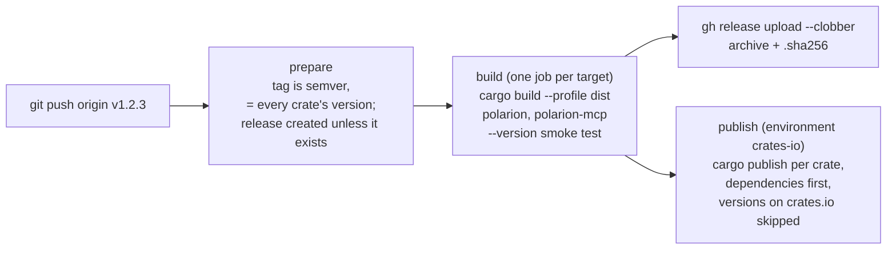

# Releasing

`.github/workflows/release.yml` turns a semver tag into a GitHub release with binaries and a crates.io release.

## Cutting a release

1. Set `version` in `[workspace.package]` of the root `Cargo.toml` and the `version` of the internal crates in
   `[workspace.dependencies]` to the new version; commit, and let CI pass on `main`.
2. Tag and push: `git tag v1.2.3 && git push origin v1.2.3` (`1.2.3` without `v` works too). A tag with a
   pre-release part (`v1.2.3-rc.1`) makes a GitHub pre-release; crates.io gets the same version.

`prepare` refuses a tag that is not a semantic version or does not match the crates' versions, before anything
is created.

## What each job does

| Job | Does | On a re-run |
|---|---|---|
| `prepare` | checks the tag; `gh release create --generate-notes` | an existing release is left as it is (title, notes, assets) |
| `build` | builds both binaries for the target, runs `--version`, packs them with README and licenses, uploads the archive and its SHA-256 | the target's archive is replaced (`--clobber`); other assets stay |
| `publish` | `cargo publish --locked` for each crate in dependency order | crates whose version is on crates.io already are skipped |

`publish` runs only when every build succeeded, so crates.io never gets a version whose binaries failed to build.

Targets, each on a native runner (the TLS library `aws-lc-sys` builds C code, so nothing is cross-compiled except
Intel macOS on Apple silicon):

| Target | Runner | Archive |
|---|---|---|
| `x86_64-unknown-linux-gnu` | `ubuntu-22.04` (glibc 2.35) | `.tar.gz` |
| `x86_64-unknown-linux-musl` | `ubuntu-22.04`, `musl-gcc` (static) | `.tar.gz` |
| `aarch64-unknown-linux-gnu` | `ubuntu-22.04-arm` | `.tar.gz` |
| `aarch64-unknown-linux-musl` | `ubuntu-22.04-arm`, `musl-gcc` (static) | `.tar.gz` |
| `x86_64-apple-darwin` | `macos-latest` | `.tar.gz` |
| `aarch64-apple-darwin` | `macos-latest` | `.tar.gz` |
| `x86_64-pc-windows-msvc` | `windows-latest` | `.zip` |
| `aarch64-pc-windows-msvc` | `windows-11-arm` | `.zip` |

The `dist` profile (root `Cargo.toml`) is `release` with thin LTO and stripped symbols.

## Setup

- crates.io: an API token with the scopes `publish-new` and `publish-update`, stored as the secret
  `CARGO_REGISTRY_TOKEN` of the environment `crates-io` (Settings > Environments; required reviewers there make
  every crates.io upload wait for approval).
- The ARM runners (`ubuntu-22.04-arm`, `windows-11-arm`) are free for public repositories.

## Trying it without a release

Actions > Release > Run workflow builds every target and keeps the archives as workflow artifacts; it creates no
release and publishes nothing.

## Docker images

`.github/workflows/docker.yml` builds the images `polarion-cli` and `polarion-mcp` (the `Dockerfile`'s targets
`cli` and `mcp`, see [README](../README.md#docker)) and pushes them to Docker Hub.

| Event | Pushed tags |
|---|---|
| semver tag `v1.2.3` (or `1.2.3`) | `1.2.3`, `1.2`, `1`, `latest` |
| semver tag with a pre-release part (`v1.2.3-rc.1`) | `1.2.3-rc.1` |
| push to `main` | `edge`, `sha-<short sha>` |
| pull request, Actions > Docker > Run workflow | nothing: built and checked only |

- **Steps:** both targets are built with the GitHub Actions cache (the `test` stage, and with it the workspace's
  tests, runs once for both), loaded, checked by [`docker/check-images.sh`](../docker/check-images.sh) (no Polarion
  server: the binaries run, every built-in profile starts, `read-only` removes the write scope), and only then
  pushed from the cache.
- **Platform:** `linux/amd64` only.
- **Setup** (Settings > Secrets and variables > Actions): the secrets `DOCKERHUB_USERNAME` and `DOCKERHUB_TOKEN`
  (an access token with Read & Write); the variable `DOCKERHUB_NAMESPACE` when the repositories belong to an
  organization instead of that user; optionally the variable `BASE_REGISTRY`, a mirror of the official base images.
  A push without the secrets fails; pull requests build without them.
