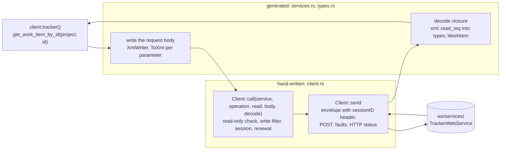
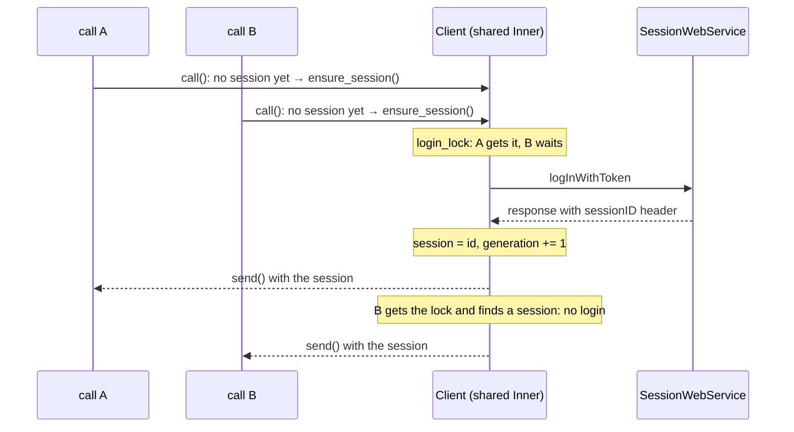
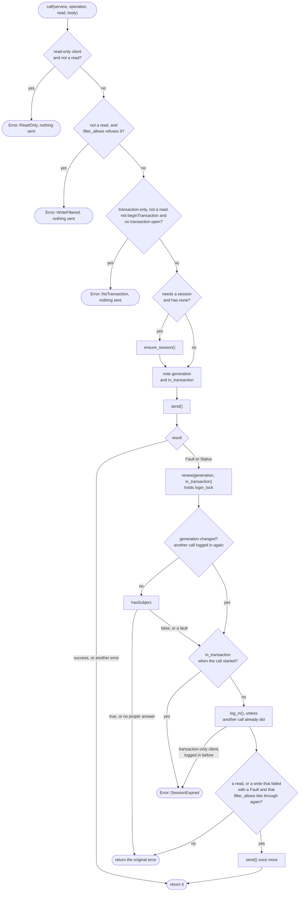

# SOAP client (`polarion-soap`)

Most of the crate is generated from the WSDLs (see [Code generation](code-generation.md)). The hand-written runtime is
small:
- [`client.rs`](../crates/polarion-soap/src/client.rs): envelope, session, renewal, faults, read-only mode, write
  filter
- [`xml.rs`](../crates/polarion-soap/src/xml.rs): XML writer and reader helpers
- [`error.rs`](../crates/polarion-soap/src/error.rs)

## What a call goes through

- **Generated code knows the operation:** each service method builds the request element and passes `read`
  (whether the operation is a read, decided by the generator) and a `decode` closure for the response element.
- **The runtime knows the protocol:** it wraps the body in an envelope with every WSDL namespace (`NAMESPACES`) and
  the `sessionID` header, posts it to `ws/services/<Service>`, and turns a `soapenv:Fault` into `Error::Fault`.
  Non-SOAP error pages (proxies, gateways) become `Error::Status`.
- **One client, all services:** `Client` is cheap to clone, and clones share one `Inner`: the HTTP client with its
  cookie store, and the session. `ClientBuilder` is `Clone` too, and every `build()` makes a new `Inner`: a client
  with its own HTTP client, cookies and session.

## The session

The client logs in lazily, on the first call that needs a session, with `logInWithToken` (personal access token) or
`logIn` (user and password). The `sessionID` header in the login response is kept in `Inner.session` and sent with
every later call. Only four session operations work without a session, and they never trigger a login or a
renewal: `logIn`, `logInWithToken`, `endSession` and `hasSubject`.

Concurrent calls share one login. `login_lock` (a `tokio::sync::Mutex`) serializes logins. `ensure_session` checks
again after taking the lock, so calls that waited don't log in a second time:

`Client::logout` ends the session (`endSession`). The CLI calls it after each run, the MCP server when it stops. It
always clears the local session and the transaction flag (`clear_session`), also when `endSession` fails, and then
returns `endSession`'s error.

## Renewal after expiry

Polarion ends idle sessions, which matters for long-running processes like the MCP server. When a call that needs a
session fails with a SOAP fault or an HTTP error, `call` asks `renew` whether the session is gone, and repeats the
call once if it was renewed (a read always, a write only after a fault):

- **Ask, don't parse:** the fault Polarion sends for an expired session is undocumented, so the client doesn't try to
  recognize it. Any fault triggers a `hasSubject` probe, and only a negative answer (or a fault from the probe)
  counts as expiry.
- **`generation`:** an `AtomicU64` bumped by every login. A failed call compares it with the value at its start. If
  another call has already logged in again in the meantime, it just repeats.
- **Writes are repeated only after a fault:** a fault means the server answered and refused the call. After an HTTP
  status error a write may have been applied, so its error is returned, even though the session was renewed. A
  repeated write passes the write filter again, so a filter that counts requests (a create budget) counts the
  repeat, and may refuse it; then the original error is returned.
- **Transactions:** `send` sets `in_transaction` when `beginTransaction` succeeds and clears it on
  `endTransaction`. Repeating a call after the session (and with it the transaction) is gone would apply that one
  call on its own. So the client fails with `Error::SessionExpired` instead and leaves the decision to the caller.
- **`decode` is used once:** `call` hands `send` an `Option` of the closure, and only the attempt that succeeds
  takes it.

## Read-only mode

`ClientBuilder::read_only(true)` makes `call` refuse every operation whose generated `read` flag is false, before
anything is sent. The generator sets the flag from the operation's name (`READ_PREFIXES`: `get`, `query`, `list`,
`search`, `has`, `can`, `is`, `was`, `export`) plus `OTHER_READS` (`generateHistory`). Login and logout are always
allowed. The `polarion` library builds its client read-only whenever no writes are enabled (see
[Library](library.md#the-write-guard)).

## Write filter

`ClientBuilder::write_filter(WriteFilter)` installs a check for every operation whose `read` flag is false: `call`
passes it the operation name (`updateWorkItem`) and the request body (the operation element, without the envelope)
after the read-only check and before logging in, and `false` refuses the operation with `Error::WriteFiltered`
before anything is sent. `filter_allows` asks it, also before a write is repeated after a renewal. A `WriteFilter`
is an `Arc<dyn Fn(&str, &str) -> bool + Send + Sync>`; `Client::has_write_filter` tells whether one is set. The
`polarion` library installs one in restricted mode (`restricted::Filter`, see
[Library](library.md#the-write-guard)), so that writes made through `Polarion::soap()` are checked too.

## Transaction-only clients

`ClientBuilder::transaction_only(true)` makes a client for one transaction. `log_in` refuses every login after the
first one (`generation > 0`) with `Error::SessionExpired`, a renewal included: a new session would not hold the
transaction. `call` refuses every write except `beginTransaction` with `Error::NoTransaction` while no transaction is
open, after the write filter and before anything is sent. `Client::transaction_open` returns the local
`in_transaction` flag and sends nothing.

## Untyped values

Custom field values, field diffs and similar elements have no fixed type in the WSDL. They are `AnyValue`, decoded
from the `xsi:type` the server sends:
- XSD scalars: strings, numbers, dates, booleans, base64
- every complex type of the WSDLs (enum options, rich text, users, ...)
- `ArrayOf…` arrays

An unknown type is kept as raw XML in `AnyValue::Unknown`, never dropped. When encoding, `AnyValue` writes its
`xsi:type`, so values read from one item can be written to another.

Elements of a subtype (e.g. `EnumCustomFieldType.enumId` inside a `CustomFieldType`) are decoded into the base
struct's fields, which the generator adds for that purpose.

## Errors

| Variant | When |
|---|---|
| `Fault { code, message, detail }` | the server answered with a SOAP fault |
| `Status { status, body }` | an HTTP error without a SOAP body (or with one but not `200`) |
| `SessionExpired` | the session expired inside an explicit transaction; a transaction-only client would log in again |
| `NoTransaction { operation }` | a transaction-only client refused a write outside a transaction; nothing was sent |
| `ReadOnly { operation }` | a read-only client refused a non-read operation |
| `WriteFiltered { operation }` | the write filter refused a non-read operation; nothing was sent |
| `Login` | the login response had no `sessionID` header |
| `Http`, `Xml`, `Decode` | transport failure, malformed XML, a response that doesn't match the WSDL |
| `Url`, `Config` | bad base URL or builder settings |
