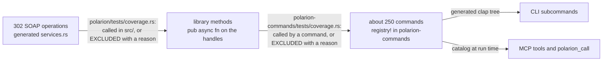
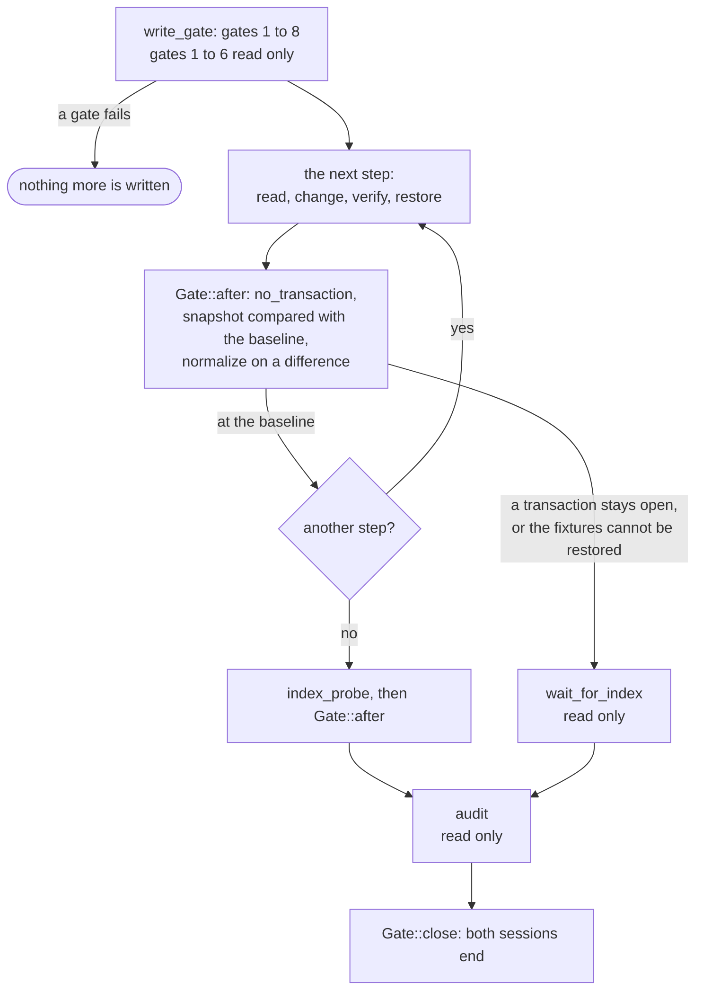

# Testing

The checks before a push are one command line, kept in one place: "Before pushing" in [CLAUDE.md](../CLAUDE.md).
CI (`.github/workflows/ci.yml`) runs them with warnings as errors and `--locked`, plus `cargo doc` and a build with
the minimum supported Rust version; for `main` and for releases it also runs the tests on Windows and macOS.
Once a month `.github/workflows/scheduled.yml` checks the dependencies for advisories and licenses
([`deny.toml`](../deny.toml), `cargo deny check advisories licenses`) and runs the tests with every dependency
at its newest compatible version.

`cargo test --workspace` never talks to a real Polarion server: everything runs against
[wiremock](https://docs.rs/wiremock) or in memory. The live suite of the library and the front ends is opt-in
(`#[ignore]`) and writes only to its own fixtures (below).

## Test layers

| Layer | Where | What it proves |
|---|---|---|
| Unit tests | `#[cfg(test)]` modules | parsing, wildcards, media types, XML helpers, ... |
| Spec round trips | `polarion-soap/tests/spec_examples.rs` (generated) | every type in the WSDLs survives a trip through the generated types |
| SOAP client | `polarion-soap/tests/http.rs` | requests on the wire, faults, read-only refusals, the write filter seeing every write before it is sent, session renewal: reads repeated after a fault or an HTTP error, writes only after a fault and only through the write filter again |
| Library | `polarion/tests/items_read.rs`, `items_write.rs`, `areas.rs`, `http.rs` | SOAP requests per method, conversions, the write guard (refused writes send nothing), objects named by URI (users, baselines, test records, work items in documents) |
| Writes of several requests | the unit tests of `polarion/src/atomic.rs`, `polarion/tests/atomic.rs`, with `session_server()` and `log()` from `tests/common/mod.rs` (every login gets a session of its own: `-1`, `-2`, ...) | which session sends what: the client's session only reads, the transaction (begin, writes, commit, logout) runs in a session of its own; single writes and writes in an open transaction stay on the client; rollback on a failed or empty follow-up, a refused or unanswered commit, a failed begin, an expired session; a dropped caller still finishing; concurrent calls in sessions of their own; creates of work items, documents, test runs and plans with their fields |
| Restricted mode | `polarion/tests/write_targets.rs`, the unit tests of `polarion/src/restricted.rs`, `client.rs`, `uri.rs` | bounded writes to the targets are sent; everything else, unbounded and legacy-guarded writes, status keys, foreign comment keys, creates beyond the budget (also when repeated after a session renewal) are refused before any request; raw `soap()` writes are filtered (hidden or added objects, objects in the wrong place, document bodies); every write operation of the generated services is classified (`ALLOWED`/`NEVER`, `every_write_operation_is_classified`) and its parameters match the filter's (`the_filter_knows_the_parameters_of_its_operations`) |
| Write targets in the front ends | `polarion-commands/src/config.rs` (unit tests), `polarion-cli/tests/cli.rs`, `polarion-cli/tests/mcp.rs`, `polarion-cli/tests/mcp_http.rs` | parsing and fail-closed configuration (empty lists, escaped commas, ids, an empty project), `-p` not moving the environment's targets, writes to a target sent and others refused with `readOnly` and nothing sent, the instructions and the HTTP startup line |
| Markdown conversion | `polarion-markdown/tests/forward.rs`, `reverse.rs`, `round_trip.rs`, `escaping.rs`, `fuzz.rs`, `mermaid.rs`, `visual.rs` (fixtures in `tests/fixtures/`, the visual model in `tests/support/visual.rs`), and its unit tests | `forward.rs`: exact HTML of every mapping, separator and id rule, the raw HTML sanitizer; `reverse.rs`: HTML to Markdown case by case, every built tree passing comrak's `validate()`, fixpoints; `round_trip.rs`: whole documents (`corpus.md`, `lossy.md`, `rte_reference.html`, `legacy_output.html`, `samples/*.html`) against golden files, in keep and drop mode, and looking the same (`support/visual.rs`); `escaping.rs`: text never turns into formatting, bounded time on deep nesting; `fuzz.rs`: random input from fixed seeds; `mermaid.rs`: hashes, names, the embedded source, rendering (feature `mermaid`), mermaid.ink URLs; all in memory, no server |
| Markdown descriptions | `polarion/tests/markdown.rs` (feature `mermaid`) | the request sequences of reading, setting and appending: guard first, render before any write, upload, reuse, pruning only what the old description showed; several uploads in one transaction, the attachments read on the client's session, then the update and deletes in a second; single writes on the client's session |
| Coverage | `polarion/tests/coverage.rs`, `polarion-commands/tests/coverage.rs` | the whole SOAP API is reachable as commands (below) |
| Command catalog | `polarion-commands/tests/registry.rs` | every command parses from its schema and survives a serialization round trip; unknown keys are refused; lenient scalars |
| Output schemas | `polarion-commands/tests/output_schemas.rs` | real results validate against their output schemas, and wrong ones don't |
| The binary end to end | `polarion-cli/tests/cli.rs`, `polarion-cli/tests/mcp.rs`, `polarion-cli/tests/mcp_http.rs` (the server's tests are with the binary, since a test finds only its own package's binary) | the built `polarion`, spawned against wiremock, as commands and as `polarion mcp`: output formats, exit codes, MCP protocol, tool selection, files, HTTP access rules, requests answered while a diagram renders, the guides (`polarion_guide` with the project section read from the mock, a failing read as a note, the resources) and the guide gate (`write`, `all`, `none`, by curated tool and `polarion_call`, nothing sent when refused, shared by HTTP clients) |
| Live suite (opt-in) | `polarion/tests/live.rs` (tiers `read`, `write`, `permanent`), `polarion-cli/tests/live.rs`, `polarion-cli/tests/mcp_live.rs`, shared `polarion/tests/live_support.rs`, the bootstrap `polarion/examples/live_fixtures.rs` | the library, the CLI and the MCP server against `POLARION_URL`, writing only to the fixtures (below); the offline checks in `live.rs` (what a baseline may contain, state files outside `target/`, planning constraint dates, record indexes, the permanent key) run with every `cargo test` |

## The coverage chain

Two coverage tests make "the CLI and the MCP server reach the whole SOAP API" a checked property:



A newer WSDL with new operations fails the first test until the library exposes them. A new library method fails
the second until it has a command. The last two links need no test: they are generated.

Golden files: `polarion-markdown/tests/fixtures/golden/NAME.md` and `NAME.drop.md` hold the Markdown of each HTML
fixture with formatting kept and dropped. After an intended change,
`UPDATE_GOLDEN=1 cargo test -p polarion-markdown --test round_trip` (PowerShell:
`$env:UPDATE_GOLDEN=1; cargo test -p polarion-markdown --test round_trip`) rewrites them; review the diff before
committing. `fuzz.rs` runs fixed seeds (about a minute in a debug build): `FUZZ_CASES=N` runs N cases per test,
`FUZZ_SEED=<hex>` only the case a failure named. CI also runs `cargo test -p polarion-markdown --no-default-features`
and `cargo check -p polarion` (the conversion without mermaid and highlighting, the library without markdown).

Diagram rendering copies a system font into a cache directory. `.cargo/config.toml` sets `XDG_CACHE_HOME` to
`target/mmdr-cache` for the processes cargo starts, unless it is already set. The end-to-end tests that render
diagrams point it at a temporary directory of their own for the binaries they spawn.

## Safety rules

- **`cargo test` never contacts a server.** Everything that does is opt-in: the live tests are `#[ignore]`, and the
  bootstrap, the only code that creates objects on a server, is an example, so
  `cargo test -- --ignored` cannot run it.
- **Writes to a real server only through the live suite**, only to its four fixtures, and only
  through a client restricted to their URIs (`PolarionBuilder::restrict_writes`, which adds the SOAP write filter;
  see [the write guard](library.md#the-write-guard)). Nothing else that writes, such as the CLI or the MCP server
  with `POLARION_WRITE_PROJECTS`, is ever pointed at such a server.
- **Every writing tier passes [the gate](#the-gate-before-any-write) before its first write**, never does what is
  on [the never list](#never-in-any-tier), and ends with [the audit](#the-audit), which checks, read-only, that
  nothing but the fixtures was changed.
- **Writes are verified against wiremock first.** What still needs a run against a real server is listed under
  "Not yet verified" in the [README](../README.md#writes); keep that list current.
- **Smoke examples are read-only.** `cargo run -p polarion --example smoke` and `-p polarion-soap --example
  soap_smoke` send a handful of read requests to the server you point them at and report each result.

## The live suite (fixtures on a real server)

The SOAP library and the front ends are checked against the server in `POLARION_URL` (a production server is
fine): they write only to four **fixtures** created once and reused on every run, because work items, test runs and
comments cannot be deleted. The tiers are in [`polarion/tests/live.rs`](../crates/polarion/tests/live.rs) and the
front ends' `tests/live.rs`, the bootstrap in
[`polarion/examples/live_fixtures.rs`](../crates/polarion/examples/live_fixtures.rs); they include what they share
(the gate, snapshots and restoring, the audit) from
[`polarion/tests/live_support.rs`](../crates/polarion/tests/live_support.rs) with `#[path]`.

| Fixture | What |
|---|---|
| A | work item of type `userstory`, title `[polarion-rs live test fixture A] automated tests, do not edit`, created with one value for each custom field type |
| B | work item of type `testcase` (`[... fixture B] ...`) |
| R | test run `POLARION_RS_LIVE` from the template `Default` (`[... fixture R] ...`) |
| D | document `polarion-rs live test fixture` in the space `_default` (`POLARION_LIVE_SPACE`), without a title, so no title heading work item is created; its body carries the marker, and it must hold no work items |

The fixtures are assigned to nobody but the token's user, never transitioned and in no plan.

### Environment

| Variable | Used by | Meaning |
|---|---|---|
| `POLARION_URL`, `POLARION_TOKEN`, `POLARION_PROJECT` | everything | the server, a personal access token of the user the suite runs as, the project of the fixtures |
| `POLARION_INSECURE=1` | everything | accept invalid TLS certificates (test servers only) |
| `POLARION_LIVE_WRITES` | the bootstrap and every writing tier | the host of `POLARION_URL` (gate 1); with anything else nothing is written |
| `POLARION_LIVE_CREATE=1` | the bootstrap | allows it to create the fixtures that are missing |
| `POLARION_LIVE_SPACE`, `POLARION_LIVE_TEMPLATE` | the bootstrap | D's space (default `_default`) and R's template (default `Default`) |
| `POLARION_LIVE_ITEMS=A-ID,B-ID`, `POLARION_LIVE_TEST_RUN`, `POLARION_LIVE_DOCUMENT=SPACE/NAME` | every writing tier; the read tier when set | the fixtures, as the bootstrap prints them; when any is set, the bootstrap only verifies |
| `POLARION_LIVE_USER` | every writing tier; the read tier and the bootstrap when set | the token's user (the author of A); the bootstrap searches by it as `author.id` |
| `POLARION_LIVE_BASELINE` | everything that reads or writes state files | the baseline file (default `~/.polarion-rs-live/<host>/<project>/baseline.json`); the other state files are next to it |
| `POLARION_LIVE_PERMANENT=YYYY-MM-DD:A-ID` | `permanent` | today's key for these fixtures, printed by the read tier |
| `POLARION_LIVE_COMMENT_TAG` | `permanent` | a comment tag set on A's comment (default: none) |

The front-end tiers start the binaries with every `POLARION_*` variable removed, the write settings, the MCP config
and the MCP tools included, and then only the connection plus `POLARION_WRITE_TARGETS` set to A's URI
(`live_support::front_end`).

### Before the first run

Check the project's notification settings (Administration > Notifications): every change of a fixture may notify
people. Watchers cannot be read through the API: check in the browser that nobody watches A, B, R or D, before the
bootstrap and before write runs. The first runs, in this order:

1. `read`, which also compares the URI formats the guards rely on with real URIs;
2. the bootstrap; set the variables it prints, and look at the fixtures in the browser;
3. `read` again, now with the fixture variables (the gate's read-only checks, the comparison with the baseline);
4. `write`; look at the audit, and at A, D and R in the browser (the diagram, the kept HTML);
5. `permanent`, once;
6. the front-end tiers.

Then move what passed from "Not yet verified" to "Checked against a real server" in the [README](../README.md#writes).

### The bootstrap

`cargo run -p polarion --example live_fixtures`, with `POLARION_LIVE_CREATE=1` and `POLARION_LIVE_WRITES` set to
the host of `POLARION_URL`:
- **With `POLARION_LIVE_ITEMS`, `POLARION_LIVE_TEST_RUN` or `POLARION_LIVE_DOCUMENT` set** it creates nothing and
  only verifies the fixtures they name.
- **Otherwise it searches first, read-only:** its log of the fixtures it created (`live-created.jsonl`), work items
  by their title (and `author.id` when `POLARION_LIVE_USER` is set), the newest 100 work items of each type with
  the marker matched in code (a query that does not depend on how the server searches titles), the test run id, the
  document location. More than one candidate for a fixture, or a fixture only one of the two work item searches
  finds, stops it.
- **It creates only what is missing**, with a client that may create exactly that many work items, test runs and
  documents in `POLARION_PROJECT` (`PolarionBuilder::allow_creates` with a `CreateBudget`) and write nothing else.
  After each create it waits until the index finds the new fixture. At the first error after a create was sent it
  stops: search for the fixtures before running it again (a create that timed out may have been applied).
- **It verifies** D's work items (one created on the side is reported) and every fixture as the gate does, and
  stores the **baseline** (the state every run restores) when there is none, only when the fixtures carry nothing a
  stopped run leaves behind (`baseline_problems`); the tiers never store one. When Polarion assigns the author on
  create, it refuses with "the user is assigned": remove the assignment in the browser and run it again.
- **It prints the variables** for the environment: `POLARION_LIVE_ITEMS=A-ID,B-ID`, `POLARION_LIVE_TEST_RUN`,
  `POLARION_LIVE_DOCUMENT=SPACE/NAME`, `POLARION_LIVE_USER` (the author of A, the token's user).

**State files** live outside the workspace's `target` folder, which `cargo clean` deletes (without the baseline
nothing can be restored, without the log the bootstrap could create a fixture twice): by default in
`~/.polarion-rs-live/<host>/<project>/` (`baseline.json`, the bootstrap's `live-created.jsonl`, the permanent tier's
`live-permanent.jsonl`), or next to `POLARION_LIVE_BASELINE`. A path inside `target/` is refused (`baseline_path`).

### Tiers

One `#[ignore]` test each, one at a time (`one_tier` refuses a second one in the same process):

```sh
cargo test -p polarion --all-features --test live read -- --ignored --nocapture
cargo test -p polarion --all-features --test live write -- --ignored --nocapture
cargo test -p polarion --all-features --test live permanent -- --ignored --nocapture
cargo test -p polarion-cli --test live -- --ignored --nocapture
cargo test -p polarion-cli --test mcp_live -- --ignored --nocapture
```

Missing variables fail with a message saying what to set. Results print as `OK`, `SKIP` and `FAIL` lines, and every
read goes through a separate read-only client (`live_support::reader`).

- `read` (`POLARION_URL`, `POLARION_TOKEN`, `POLARION_PROJECT`): reads only, `limit 1` where it lists: every area,
  the URI formats the guards rely on (`uri::owner_of` on real comment and work record URIs, `uri::test_run_uri`),
  the audit's queries and revision reads, `NotFound`, session renewal after `endSession`, Markdown reads with the
  offline round trip (no fallbacks, a fixpoint; the visual check in keep mode, where kept formatting must look the
  same; drop mode leaves formatting out, so its difference is only shown, as in
  `polarion-markdown/tests/round_trip.rs`). With the fixture variables set, also the gate's read-only checks,
  whether `get()` and the gate's fields by key agree, the formats restoring relies on, the comparison with the
  baseline, and the value of `POLARION_LIVE_PERMANENT` for today.
- `write` (the read tier's variables, `POLARION_LIVE_WRITES` and the fixture variables): after the gate, every
  bounded write on A (title and description, each custom field type, hyperlinks under `https://example.invalid/`,
  categories, planning constraints, the link to B, the user as assignee and approver, the localized title,
  attachments, a work record), Markdown with a mermaid diagram, B's test steps and R's records, R's fields, report
  and attachments, D's body, transactions, updates of several requests (one transaction in a session of its own,
  and the rollback of a refused write, reported as not verified when the server accepts it). Each step reads,
  changes, verifies and restores, and the fixtures are
  then compared with the baseline field by field. Ends with the index probe and the audit.
- `permanent` (the write tier's variables and `POLARION_LIVE_PERMANENT`): comments, which cannot be deleted, on A
  (with a reply, resolved, tags) and on D, once. Read-only and before any gate writes, it requires
  `POLARION_LIVE_PERMANENT` to be the value the read tier prints for today (`YYYY-MM-DD:A-ID`), no run for A in
  `live-permanent.jsonl` and no comment of the suite on A or D from the last day. The run is logged before the
  first comment.
- the front ends (the write tier's variables): the CLI and the MCP server (stdio), restricted to A by
  `POLARION_WRITE_TARGETS`: a read (CLI: `items query`; MCP: `tools/list` with the curated read and write tools in
  order and the refused areas in the instructions, `get_work_item_description_markdown` on A, `test_run_report` on
  R and `test_case_steps` on B, compared with the library's results),
  a Markdown write to A (restored through the library; MCP: after `polarion_guide` for work items, which the
  server requires before writes), and the harmless canary `remove-hyperlink` on another work item (CLI:
  `items remove-hyperlink`, MCP: `items.remove-hyperlink` through `polarion_call`, first refused by the guide gate
  with `guideRequired`, then, after `polarion_guide`, by the library), which must be refused with `readOnly`
  before anything is sent.

A writing tier, from the gate to the audit:



### The gate before any write

`live_support::write_gate`, before the first write of every writing tier, in this order (except that the writer of
gate 2 is built after gates 3 and 4):
1. `POLARION_LIVE_WRITES` is the host of `POLARION_URL`;
2. the writer (`live_support::writer`) is restricted to the URIs the server returned for A, B, R and D, all in
   `POLARION_PROJECT`, and nothing else: no write projects, no global writes, no create budget;
3. each fixture is what the bootstrap made: title marker, `author` is `POLARION_LIVE_USER`, assignees and
   approvers only that user, A and B in no plan and no document (read by field key), D without work items;
4. the back links of A and B come from fixtures only (a write to a linked item can mark others' links suspect);
5. the canary: `Polarion::write_allowed` is false for the newest other work item and true for each fixture, and
   the harmless `remove_hyperlink` on the canary is refused before anything is sent;
6. a baseline exists, and every difference from it can be undone (`restore_plan`, read-only);
7. the identity probe, the first write: A's title is changed and restored, and A's history must show both changes
   by `POLARION_LIVE_USER`, so no write names a user before the token's user is confirmed; the date of the first
   change is the run's start for the audit (the server's clock);
8. the fixtures are restored to the baseline, so an aborted run repairs itself.

After each step `Gate::after` makes sure no transaction is left open (one is rolled back once), compares the
fixtures with the baseline and restores them; when a transaction stays open or the fixtures cannot be restored,
nothing more is written, and the tier waits read-only for the index before the audit.

### Never, in any tier

Workflow transitions, status or resolution writes, deletes of work items, documents or plans, creates (only the
bootstrap creates), test executions, summary defects, external, OSLC and SCM links, auto-suspect, auto-assign,
users, global writes, assigning or approving anyone but `POLARION_LIVE_USER`, test results other than `passed`, and
the writer's `soap()`. Most of these the writer could not send anyway: restricted mode refuses them
([the write guard](library.md#the-write-guard)).

### The audit

`live_support::audit`, read-only, at the end of every writing tier, after the index shows the last change, in
`POLARION_PROJECT` (gate 2 keeps every target in it), since the run's start:
- no work item but A and B changed by the user: `updated:[<start day - 1> TO 99991231]`, counted first, then the
  history of each;
- no document but D changed by the user: its `updatedBy`, and its revisions since the start;
- no test run but R changed by the user: its revisions since the start;
- the back links of A and B and D's work items as before.

More than 500 objects of a kind, a work item query that finds nothing (not even A), or a truncated or failing
query, is a `FAIL`. After the attachment, work record, approval and comment writes the suite checks that they show
in A's `updated` and history (`mark`, `audit_sees`); when they do not, a `SKIP` says that the audit cannot see such
writes on other work items. Editing in the browser as the token's user during a run causes false alarms.

### What stays behind

Accepted: new revisions and history entries on every fixture and their `updated` timestamps, attachment counters
and the contents of deleted attachments in the repository history, approval history, R's status following its
records, D's HTML as Polarion normalizes it, and the permanent tier's comments.
