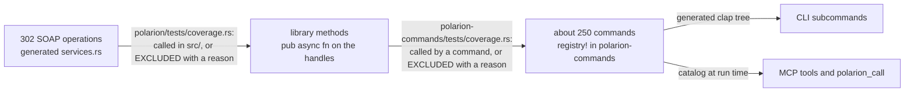

# Testing

```sh
cargo xtask codegen --check && cargo fmt --all --check && cargo clippy --workspace --all-targets && cargo test --workspace
```

`cargo test --workspace` never talks to a real Polarion server: everything runs against
[wiremock](https://docs.rs/wiremock) or in memory. The live tests are opt-in and only target Siemens' public test
drive.

## Test layers

| Layer | Where | What it proves |
|---|---|---|
| Unit tests | `#[cfg(test)]` modules | parsing, wildcards, media types, XML helpers, ... |
| Spec round trips | `polarion-rest/tests/spec_examples.rs`, `polarion-soap/tests/spec_examples.rs` (generated) | every schema in the OpenAPI spec and the WSDLs survives a trip through the generated types |
| Protocol clients | `polarion-rest/tests/http.rs`, `polarion-soap/tests/http.rs` | requests on the wire, faults, read-only refusals, session renewal |
| Library | `polarion/tests/items_read.rs`, `items_write.rs`, `areas.rs`, `http.rs` | SOAP requests per method, conversions, the write guard (refused writes send nothing) |
| Coverage | `polarion/tests/coverage.rs`, `polarion-commands/tests/coverage.rs` | the whole SOAP API is reachable as commands (below) |
| Command catalog | `polarion-commands/tests/registry.rs` | every command parses from its schema and survives a serialization round trip; unknown keys are refused; lenient scalars |
| Output schemas | `polarion-commands/tests/output_schemas.rs` | real results validate against their output schemas, and wrong ones don't |
| Binaries end to end | `polarion-cli/tests/cli.rs`, `polarion-mcp/tests/mcp.rs`, `polarion-mcp/tests/http.rs` | the built binaries, spawned against wiremock: output formats, exit codes, MCP protocol, tool selection, files, HTTP access rules |
| Live (opt-in) | `polarion-rest/tests/live.rs` | the REST client against testdrive.polarion.com |

## The coverage chain

Two coverage tests make "the CLI and the MCP server reach the whole SOAP API" a checked property:



A newer WSDL with new operations fails the first test until the library exposes them. A new library method fails
the second until it has a command. The last two links need no test: they are generated.

## Safety rules

- **Never write to a production server.** Anything that writes only ever targets testdrive.polarion.com, and the
  live tests hard-code that URL so they cannot touch another instance.
- **Writes are verified against wiremock only.** What still needs a run against a real sandbox is listed under
  "Not yet verified" in the [README](../README.md#writes); keep that list current.
- **Smoke examples are read-only.** `cargo run -p polarion --example smoke`, `-p polarion-soap --example
  soap_smoke` and `-p polarion-rest --example rest_smoke` send a handful of read requests to the server you point
  them at and report each result.

## Live tests (testdrive only)

[`polarion-rest/tests/live.rs`](../crates/polarion-rest/tests/live.rs) runs against Siemens' public test drive
server:
- `read_tour` is read-only.
- `work_item_lifecycle` creates three work items in your Sandbox project. It exercises update, bulk update, query
  and pagination, links, comments, and attachment upload and download, then deletes the items again (also when a
  step fails).

```sh
export POLARION_TESTDRIVE_TOKEN=<personal access token created on testdrive.polarion.com>
export POLARION_TESTDRIVE_PROJECT=<your project in the testdrive Sandbox>
cargo test -p polarion-rest --test live -- --ignored --nocapture --test-threads=1
```
