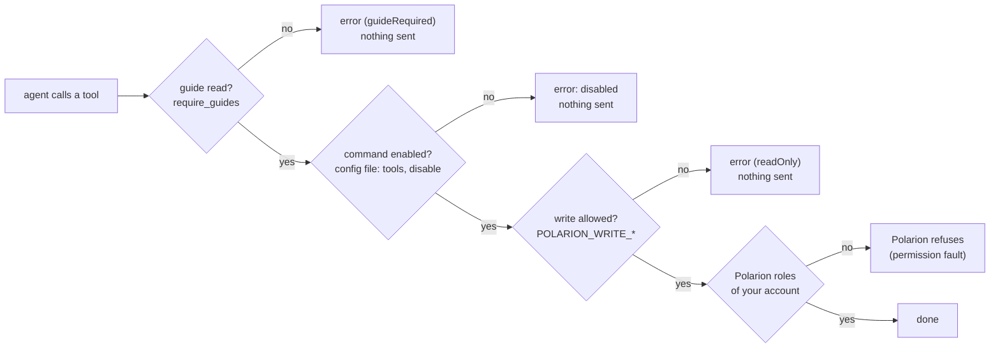

# Setting up the MCP server (`polarion mcp`) on your machine

A step-by-step setup of the MCP server, `polarion mcp`, on Windows, from read-only up to full write access, with
ready-to-copy configurations for Claude Code, Claude Desktop, VS Code and Codex. The reference for every option is
the [README](../../README.md#polarion-mcp-mcp-server); this page shows how to combine the options.

```
examples/mcp/
├── README.md                       this guide
├── config/                         tool selection (polarion mcp --config FILE)
│   ├── full-access.toml            curated tools, everything else through polarion_call
│   ├── every-tool.toml             every command as a tool of its own
│   ├── no-deletes.toml             writes without deletes and user accounts
│   └── read-only.toml              reads only, baseline and revision reads as tools
├── scripts/
│   ├── Save-PolarionSettings.ps1   stores URL, project, write scope; the token encrypted
│   ├── Start-PolarionMcp.ps1       the command every client starts
│   └── Test-PolarionMcp.ps1        shows what a configuration offers, optionally logs in
└── clients/
    ├── claude-code.ps1             claude mcp add ... for each scenario
    ├── claude-code.mcp.json        project .mcp.json (stdio, through the launcher)
    ├── claude-code-direct.mcp.json project .mcp.json without the launcher
    ├── claude-code-http.mcp.json   project .mcp.json for the HTTP server
    ├── claude_desktop_config.json  Claude Desktop
    ├── vscode.mcp.json             VS Code (stdio and HTTP)
    └── codex.config.toml           OpenAI Codex CLI
```

The paths in the client files say `C:/Polarion-rs/...`; replace that with the folder of your checkout, or copy
`examples/mcp` somewhere and point them there. Forward slashes work on Windows and need no escaping in JSON.

## 1. How permissions work

Four independent layers decide whether a call goes through. Each can only take away, never add:



| Layer | Set by | What it decides |
|---|---|---|
| Polarion account | the token (`POLARION_TOKEN`) | everything the server may do at all: the MCP server can never do more than you can in the Polarion UI |
| Write scope | `POLARION_WRITE_PROJECTS`, `POLARION_ALLOW_GLOBAL_WRITES`, `POLARION_WRITE_TARGETS` | which writes are sent; without any of them the server is read-only |
| Tool selection | config file (`tools`, `disable`), `POLARION_MCP_TOOLS` | which commands have a tool of their own, and which are switched off entirely |
| Guide gate | `require_guides`, `POLARION_MCP_REQUIRE_GUIDES` | whether an area's guide must be read before its writes (default) or all its commands |

**"All permissions"** therefore means: every project you work in listed in `POLARION_WRITE_PROJECTS`,
`POLARION_ALLOW_GLOBAL_WRITES=1`, and nothing disabled in the config file. There is no wildcard for projects: each one
is named (`Save-PolarionSettings.ps1 -AllProjects` asks Polarion for the list). The guide gate can stay on; it does
not restrict what can be written, it makes the agent read the project's types, statuses, link roles and custom
fields before its first write in an area, which avoids most failed writes.

Writes that need global writes: user accounts (`users.create`, `users.update`), the account vault
(`security.update-user-account-vault`), global folders and comments on activities. Everything else belongs to a
project.

Even with full access, some things stay refused:

- explicit transactions (`session.begin-transaction`, `commit`, `rollback`) over HTTP, since all HTTP clients
  share one Polarion session (they work over stdio);
- with `POLARION_WRITE_TARGETS`: creates, deletes of whole objects, workflow actions, status and resolution
  changes, and the body of a document that holds work items;
- projects created after the server started, until they are added to `POLARION_WRITE_PROJECTS` and the client
  is restarted.

## 2. Prerequisites

1. **The binary.** `polarion` is the command line and, as `polarion mcp`, the server:

   ```powershell
   cargo install polarion-cli                       # from crates.io
   # or from this checkout:
   cargo install --path crates/polarion-cli
   ```

   Or download it (x86-64; ARM64: `aarch64-pc-windows-msvc`) into a folder on `PATH`:

   ```powershell
   curl.exe -fL https://github.com/KevinGliewe/Polarion-rs/releases/latest/download/polarion-rs-x86_64-pc-windows-msvc.exe -o polarion.exe
   ```

   Check: `polarion mcp --version`. If you used a version before 0.4, remove the old `polarion-mcp.exe`
   (`cargo uninstall polarion-mcp`): the server is no longer a program of its own.

2. **PowerShell 7** (`pwsh`, `winget install Microsoft.PowerShell`). The clients start the launcher with it;
   `Test-PolarionMcp.ps1`, `-HttpToken` and `claude mcp add ... -- ...` (Windows PowerShell 5.1 drops the `--`)
   need it too.

3. **A Polarion personal access token**: in Polarion, your user menu → *My Account* → *Personal Access Tokens*. Its
   permissions are your account's. (`POLARION_USER` + `POLARION_PASSWORD` also work, set in the client's `env`
   block; the scripts handle tokens only.)

## 3. Save your settings once

`Save-PolarionSettings.ps1` keeps the token out of every client configuration: it is stored encrypted for your
Windows user (DPAPI) in `%APPDATA%\polarion-mcp\token.txt`. The other settings become user environment variables,
which the `polarion` CLI picks up as well.

```powershell
cd C:\Polarion-rs\examples\mcp\scripts

# Full access: every project you can see, global writes, an exchange folder for files.
.\Save-PolarionSettings.ps1 -Url https://polarion.example.com/polarion -Project MyProject `
    -AllProjects -GlobalWrites -FilesDir "$HOME\polarion-files"

# Or name the projects yourself:
.\Save-PolarionSettings.ps1 -Url https://polarion.example.com/polarion -Project MyProject `
    -WriteProjects MyProject,OtherProject -GlobalWrites

# Or read-only:
.\Save-PolarionSettings.ps1 -Url https://polarion.example.com/polarion -Project MyProject
```

It asks for the token (input hidden); `-KeepToken` keeps the stored one when you only change other settings. It
prints what it saved. Restart your MCP clients and open a new terminal afterwards.

| Setting | Variable | Notes |
|---|---|---|
| `-Url` | `POLARION_URL` | base URL including `/polarion` |
| `-Project` | `POLARION_PROJECT` | default project: `MP-42` and `Specs/SRS` mean this project; `polarion_guide` reads its types and fields from here |
| `-WriteProjects`, `-AllProjects` | `POLARION_WRITE_PROJECTS` | comma-separated project ids, exact spelling |
| `-GlobalWrites` | `POLARION_ALLOW_GLOBAL_WRITES=1` | writes not tied to a project |
| `-FilesDir` | `POLARION_MCP_FILES` | exchange folder (see [Files](#files-attachments-and-pdfs)) |
| `-HttpToken` | `POLARION_MCP_AUTH_TOKEN` | a new random bearer token for the HTTP server |
| `-Insecure` | `POLARION_INSECURE=1` | accept invalid TLS certificates; test servers only |
| (prompt) | `%APPDATA%\polarion-mcp\token.txt` | the token, DPAPI-encrypted; only your Windows user on this machine can read it |

`Start-PolarionMcp.ps1` is what the clients run. It reads these settings from the registry (`HKCU\Environment`)
rather than from its inherited environment, because MCP clients start servers with an environment of their own,
which does not always contain your user variables. It decrypts the token, sets everything for `polarion mcp`
only, and starts it with stdin and stdout passed straight through. Variables the client sets in its `env` block
win over the saved ones, and `-ReadOnly` drops the saved write settings.

## 4. Pick a scenario

| Scenario | Launcher arguments | Tools listed | Use when |
|---|---|---|---|
| A. Full access (recommended) | `-Config full-access` | 48: 25 reads, 19 writes, `polarion_guide`, 3 generic | your own work, any project |
| B. Full access, every tool | `-Config every-tool` | about 257 | the agent should see every command without `polarion_call` |
| C. Writes without deletes | `-Config no-deletes` | 48 | full access, but no delete can happen by accident |
| D. Sandbox | `-Config full-access` plus `POLARION_WRITE_TARGETS` | 48 (creates refused) | letting an agent change only named objects |
| E. Read-only | `-Config read-only -ReadOnly` | 35, reads only | exploring, reporting, production data |
| F. Shared HTTP server | `-Http 127.0.0.1:8787 -Config ...` | as the config says | several clients at once, one server process |

Tool counts are for writes enabled (A–D) and come from `Test-PolarionMcp.ps1`; with the scripts in
[step 6](#6-check-the-setup) you see the exact list for your settings.

### A. Full access (recommended)

[`config/full-access.toml`](config/full-access.toml): the 25 everyday reads and 19 everyday writes as tools of
their own. The other ~200 commands (baselines, revisions, folders, security checks, users, workflow actions, test
attachments, ...) stay reachable through three generic tools: `polarion_commands` lists them,
`polarion_describe` shows a command's arguments, and `polarion_call` runs it, with exactly the same write checks.
This keeps the tool definitions at about 92 KB.

Saved settings: `-AllProjects -GlobalWrites` (or `-WriteProjects ...`). Client argument: `-Config full-access`.

### B. Full access, every command as a tool

[`config/every-tool.toml`](config/every-tool.toml): `tools = "all"`, output schemas off (they are the larger half
of each definition): about 135 KB for 257 tools. Claude Code loads MCP tools on demand when there are many, so
the size matters less there; Claude Desktop and others put the whole list in the context.

### C. Writes, but no deletes

[`config/no-deletes.toml`](config/no-deletes.toml) disables `*.delete`, `*.delete-*` and the user-account commands.
A disabled command has no tool, is not listed by `polarion_commands`, and is refused by `polarion_describe` and
`polarion_call`: it is a real deny list. Adjust the `disable` list to taste; a selector that matches nothing stops
the server with an error, so typos are noticed at once.

Selectors are command names (`items.delete`, `items.*`, `*.delete`), tool names (`get_work_item`,
`items_add_hyperlink`) or the generic tools (`polarion_call`). `polarion commands` lists every command; `polarion
commands items` one area.

### D. Sandbox: only named objects

Set `POLARION_WRITE_TARGETS` in the client entry; it overrides the saved write projects and global writes:

```powershell
claude mcp add polarion-sandbox --scope user `
    -e "POLARION_WRITE_TARGETS=MP-42,doc:Specs/Scratch,run:MP-Sandbox-Run" -- `
    pwsh -NoProfile -NonInteractive -File C:/Polarion-rs/examples/mcp/scripts/Start-PolarionMcp.ps1 -Config full-access
```

Entries: `ID` or `PROJECT/ID` (work items), `doc:SPACE/NAME` or `doc:PROJECT/SPACE/NAME`, `run:ID` or
`run:PROJECT/ID`, or a URI; comma-separated, `\,` for a comma inside a name. Entries without a project are in
`POLARION_PROJECT`. The fields, comments, attachments, work records and test records of the targets may be
changed; every other object a write names (link targets, test cases, plan items) must be a target as well. Creates,
deletes of whole objects, workflow actions and status changes are refused. A target list that does not parse stops
the server at startup.

### E. Read-only

`-ReadOnly` ignores whatever write settings were saved, so a read-only entry can live next to a full-access one.
[`config/read-only.toml`](config/read-only.toml) adds the baseline and revision reads as tools; without a config file you
get the 25 reads, `polarion_guide` and the 3 generic tools (29 tools, about 71 KB).

### F. Shared HTTP server on localhost

One process serves any number of clients at `http://127.0.0.1:8787/mcp`. All of them act as the server's account and
share one Polarion session.

```powershell
.\Save-PolarionSettings.ps1 -Url ... -Project MyProject -AllProjects -GlobalWrites -HttpToken -KeepToken
.\Start-PolarionMcp.ps1 -Http 127.0.0.1:8787 -Config full-access     # keep this window open
```

Clients send the token as `Authorization: Bearer <POLARION_MCP_AUTH_TOKEN>`, or, where a client cannot set
headers, in the URL: `http://127.0.0.1:8787/mcp/<token>` (it then shows up wherever the URL is logged). See
[`clients/claude-code-http.mcp.json`](clients/claude-code-http.mcp.json) and
[`clients/vscode.mcp.json`](clients/vscode.mcp.json) (`polarion-http`, which asks for the token once). Notes:

- Bind to `127.0.0.1`. The server speaks plain HTTP and answers only to the `Host` names in
  `POLARION_MCP_ALLOWED_HOSTS` (default `localhost`, `127.0.0.1`, `::1`). For anything beyond this machine, put a
  TLS reverse proxy in front and list its name there.
- Browser-based clients (with an `Origin` header) are refused unless the origin is in `POLARION_MCP_ALLOWED_ORIGINS`
  (scheme and port, e.g. `http://localhost:3000`).
- The guides an agent read are remembered per process, so over HTTP one client's `polarion_guide` call opens the
  gate for all.
- Transactions are refused over HTTP; use stdio for them.
- Claude Desktop connects to remote servers only through OAuth connectors, which this server does not offer; use
  stdio there.

## 5. Register the server in your client

Use one entry per client. Two entries with the same tools (say `polarion` and `polarion-sandbox`) both appear to the
agent; give them distinct purposes, or keep one.

### Claude Code

[`clients/claude-code.ps1`](clients/claude-code.ps1) has a `claude mcp add` command for every scenario. The common
case:

```powershell
claude mcp add polarion --scope user -- `
    pwsh -NoProfile -NonInteractive -File C:/Polarion-rs/examples/mcp/scripts/Start-PolarionMcp.ps1 -Config full-access
claude mcp list
```

`--scope user` makes it available in every project. For one repository only, copy
[`clients/claude-code.mcp.json`](clients/claude-code.mcp.json) to `.mcp.json` in its root (Claude Code asks once
whether to trust it). [`clients/claude-code-direct.mcp.json`](clients/claude-code-direct.mcp.json) skips the launcher
and takes `${POLARION_TOKEN}` and the others from the environment Claude Code runs in; then the token must be a
plain environment variable.

In a session, `/mcp` shows the server, its status and its tools.

### Claude Desktop

Settings → Developer → *Edit Config* opens `claude_desktop_config.json` (`%APPDATA%\Claude\`; for the Microsoft Store
version under `%LOCALAPPDATA%\Packages\Claude_*\LocalCache\Roaming\Claude\`). Merge the `polarion` entry from
[`clients/claude_desktop_config.json`](clients/claude_desktop_config.json) into its `mcpServers` and restart Claude
Desktop completely (tray icon → Quit). Its logs are in `%APPDATA%\Claude\logs\mcp-server-polarion.log`.

### VS Code (GitHub Copilot agent mode)

Command palette → *MCP: Open User Configuration* (all workspaces) or create `.vscode/mcp.json` (this workspace), and
take the entries from [`clients/vscode.mcp.json`](clients/vscode.mcp.json). VS Code uses `servers`, not
`mcpServers`. Start the server from the code lens above the entry, or with *MCP: List Servers*.

### OpenAI Codex CLI

Append [`clients/codex.config.toml`](clients/codex.config.toml) to `%USERPROFILE%\.codex\config.toml`.

### Other clients

Anything that starts a stdio server takes the same command line:

```
pwsh -NoProfile -NonInteractive -File C:/Polarion-rs/examples/mcp/scripts/Start-PolarionMcp.ps1 -Config full-access
```

## 6. Check the setup

`Test-PolarionMcp.ps1` starts the server exactly as a client does and prints the write scope the agent will be told
and the tools it will see. With `-Call` it also logs in and reads the default project:

```powershell
.\Test-PolarionMcp.ps1 -Config full-access -Call
```

```
Server:  polarion-mcp 0.x.y
Scope:   Writes are enabled for: MyProject, OtherProject, global writes.
Tools:   48 (about 92 KB of definitions)

get_work_item, query_work_items, ..., create_work_item, update_work_item, ..., polarion_call

get_project: MyProject (My Project)
```

Then, in the client, ask the agent something like *"Which Polarion projects may you write to?"* (it is told on
connect) and *"Read the work-items guide and show me MP-42."*

## Files: attachments and PDFs

Without an exchange folder, images among attachments come back as images the model can see, UTF-8 text as text,
and anything else only as its size and type. With `-FilesDir` (`POLARION_MCP_FILES`):

- downloads (`items.attachment`, `export_document_pdf`) take `save_as: "spec.pdf"` and write the file there;
- uploads (`add_work_item_attachment`, `tests.add-attachment`, ...) take `data-file: "notes.txt"` and read it from
  there.

Only plain file names inside that folder are accepted: no paths, no `..`, no symbolic links. Over stdio it is a
folder on your machine, so you and the agent can both open what was saved.

## Environment reference

| Variable | Default | Meaning |
|---|---|---|
| `POLARION_URL` | (required) | Polarion base URL |
| `POLARION_TOKEN` | (required, or the two below) | personal access token |
| `POLARION_USER`, `POLARION_PASSWORD` | | user name and password instead of a token |
| `POLARION_PROJECT` | | default project for ids without one, and for `polarion_guide` |
| `POLARION_INSECURE` | off | `1`: accept invalid TLS certificates |
| `POLARION_WRITE_PROJECTS` | none | projects that may be written; none and no global writes: read-only |
| `POLARION_ALLOW_GLOBAL_WRITES` | off | `1`: writes not tied to a project |
| `POLARION_WRITE_TARGETS` | unset | only these objects may be written; set, it overrides the two above |
| `POLARION_MCP_CONFIG` | | the config file, as `--config FILE` |
| `POLARION_MCP_TOOLS` | `default` | the config file's `tools`, comma-separated; wins over the file |
| `POLARION_MCP_REQUIRE_GUIDES` | `write` | `write`, `all` or `none`; wins over the file |
| `POLARION_MCP_FILES` | off | exchange folder (must exist) |
| `POLARION_MCP_HTTP` | | serve HTTP at this address, as `--http ADDR` |
| `POLARION_MCP_AUTH_TOKEN` | (required for HTTP) | token clients must send, 16+ characters: `Authorization: Bearer <token>` or the URL `/mcp/<token>` |
| `POLARION_MCP_ALLOW_UNAUTHENTICATED` | off | `1`: HTTP without a token (instead of `POLARION_MCP_AUTH_TOKEN`); everyone who reaches the port acts as your account |
| `POLARION_MCP_ALLOWED_HOSTS` | `localhost,127.0.0.1,::1` | `Host` names the HTTP server answers to |
| `POLARION_MCP_ALLOWED_ORIGINS` | none | browser origins allowed to connect |

Flags (`1`) also accept `true`, `yes` and `on`.

## Config file reference

Every key is optional; an unknown key, a selector that matches nothing or an unreadable file stops the server with
an error naming the problem.

```toml
tools = ["default", "baselines.query"]   # commands with a tool of their own; "default" or "all"
disable = ["*.delete", "polarion_describe"]   # switched off everywhere, polarion_call included
output_schemas = true                # outputSchema on tools, structuredContent on results
require_guides = "write"             # "write" (default), "all" or "none"
```

The guide areas: `work-items` for work item commands; `documents`, `tests`, `plans` and `wiki` for theirs;
`overview` for every other area (schema, projects, users, ...). Disabling `polarion_guide` turns the gate off.

## Troubleshooting

| Symptom | Cause and fix |
|---|---|
| `error (readOnly): ...` | the write is outside the write scope: the project is not in `POLARION_WRITE_PROJECTS` (spelling is exact), a global write without `POLARION_ALLOW_GLOBAL_WRITES`, an object that is not a write target, or `-ReadOnly`. `Test-PolarionMcp.ps1` shows the scope |
| `error (guideRequired): ...` | expected: the agent calls `polarion_guide` for that area and repeats the call. `require_guides = "none"` turns it off |
| `command ... is disabled on this server` | it is in the config file's `disable` |
| A write tool is missing | curated writes are listed only when writes are enabled; check the scope |
| Polarion permission fault | your account lacks the role; the MCP server cannot do more than you can in Polarion |
| Server fails to start, `config file ...: ...` | the message names the key and the selector; fix the TOML |
| `Start-PolarionMcp: no token` | run `Save-PolarionSettings.ps1` as the same Windows user the client runs as |
| `Key not valid for use in specified state` | the token file was written by another user or machine (DPAPI); save the token again |
| `pwsh` not found | install PowerShell 7, or use the full path `C:/Program Files/PowerShell/7/pwsh.exe` as the command |
| `... cannot be loaded because running scripts is disabled` | the execution policy blocks scripts: `Unblock-File` on the scripts if they were downloaded, or add `-ExecutionPolicy Bypass` before `-File` (if your organisation's policy allows it) |
| `polarion` not found | it is not on the `PATH` the client sees; pass `-Exe C:/path/to/polarion.exe` to the launcher |
| `unrecognized subcommand 'mcp'` | an older `polarion` (before 0.4) is first on the `PATH`; install the current one |
| `-Exe names polarion-mcp, which no longer exists` | an entry from before 0.4: pass the `polarion` binary, or drop `-Exe` |
| Settings changes have no effect | clients start the server once; restart the client (Claude Desktop: Quit from the tray) |
| A new project cannot be written | run `Save-PolarionSettings.ps1 -AllProjects -GlobalWrites -KeepToken` again, then restart the client |
| TLS errors on a test server | `-Insecure`; never for production |

## Security notes

- Whatever the agent does is done as you: Polarion's history shows your account. Full access lets a confused or
  misled agent change or delete anything you can, in every listed project. Scenario C (no deletes) or D (targets)
  limits the damage; Polarion's history and baselines are the way back.
- Content the agent reads (descriptions, comments, wiki pages) can contain instructions written by others. With
  full access, prefer clients that ask before each write tool call, and keep that confirmation on.
- The token file is readable only by your Windows account, but any program running as you can decrypt it. Revoke the
  token in Polarion when you stop using it.
- Do not point a full-access setup at a server where an agent's mistake would be costly unless you mean it; a
  read-only entry (`-ReadOnly`) next to it is cheap.
